<div align="center">

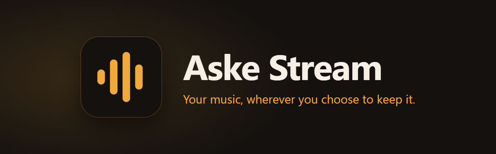

**Tu música, guardada donde tú elijas.**

[English](README.md) · Español · [Euskara](README.eu.md)

[](https://github.com/Ando144/aske-stream/actions/workflows/ci.yml)
[](https://github.com/Ando144/aske-stream/actions/workflows/android.yml)
[](https://github.com/Ando144/aske-stream/releases/latest)
[](LICENSE)
[](https://github.com/Ando144/aske-stream/releases)
[](docs/development.md)
[](tsconfig.base.json)

**[Descargar la app de Android](https://github.com/Ando144/aske-stream/releases/latest)** ·
[Documentación](docs/README.md) ·
[Arquitectura](docs/architecture.md) ·
[Cómo colaborar](CONTRIBUTING.md)

</div>

<table align="center">
  <tr>
    <td align="center">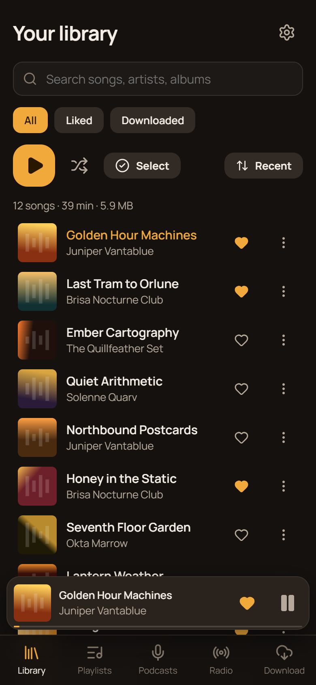<br /><sub>Tus canciones</sub></td>
    <td align="center">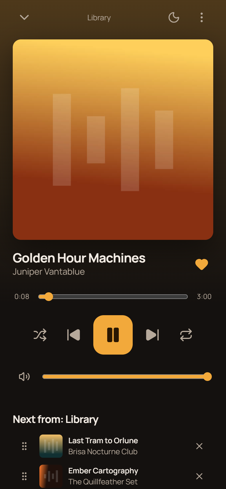<br /><sub>Reproductor y cola</sub></td>
    <td align="center">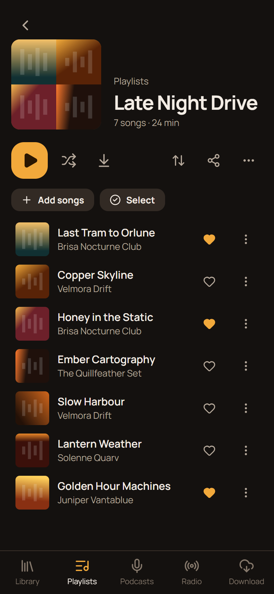<br /><sub>Playlists</sub></td>
    <td align="center">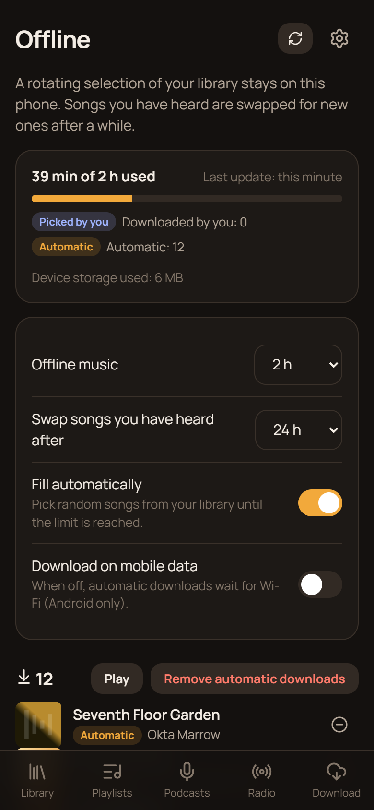<br /><sub>Música sin conexión</sub></td>
  </tr>
  <tr>
    <td align="center">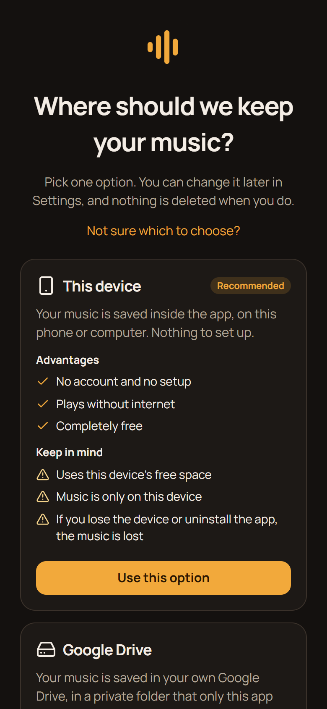<br /><sub>Tú eliges dónde se guarda</sub></td>
    <td align="center">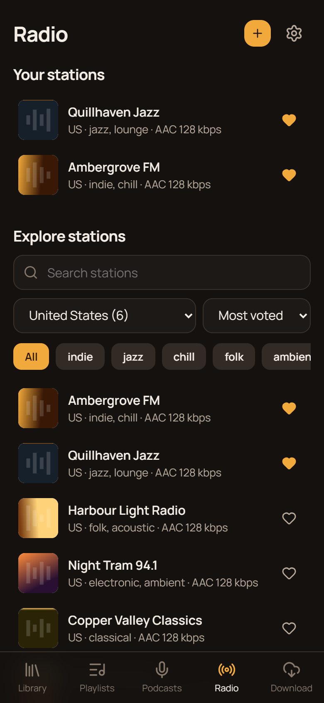<br /><sub>Radio en directo</sub></td>
    <td align="center">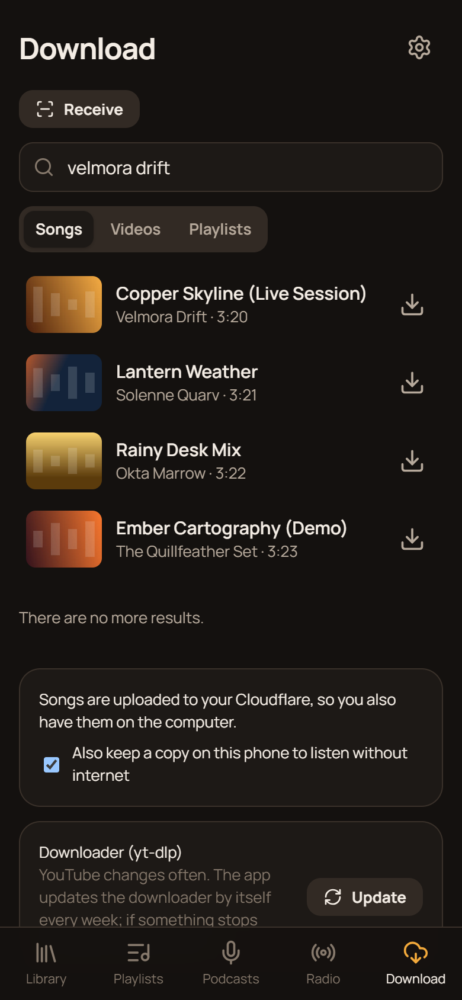<br /><sub>Descargar (Android)</sub></td>
    <td align="center">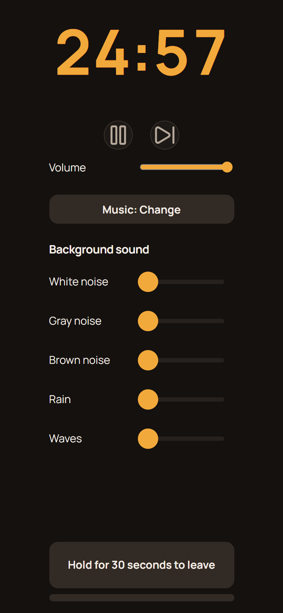<br /><sub>Modo estudio (Android)</sub></td>
  </tr>
</table>

<p align="center">
  
  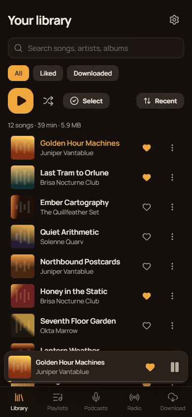
</p>

<p align="center">
  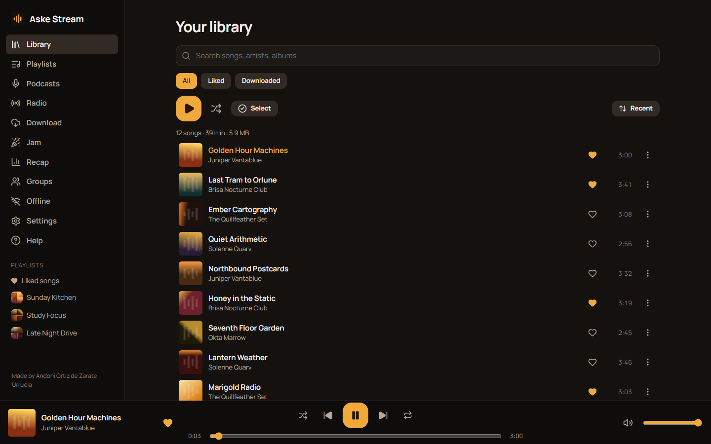
</p>

<p align="center"><sub>Toda la música, los artistas y las emisoras de las imágenes son inventados. Las capturas muestran la app en inglés.</sub></p>

## Qué es

Aske Stream es una app de música de código abierto, parecida a Spotify, pensada para amigos sin
conocimientos técnicos. No hay un servicio central de música: cada persona elige dónde se guarda la
suya y puede cambiarlo más adelante sin que se borre nada. Funciona en el navegador, como app web
que se puede instalar, y en Android, con un archivo APK que se actualiza solo desde la propia app.

_Aske_ significa «libre» o «gratis» en euskera.

|                          | Este dispositivo                    | Google Drive                              | Tu propio Cloudflare                          |
| ------------------------ | ----------------------------------- | ----------------------------------------- | --------------------------------------------- |
| Preparación              | Ninguna                             | Entrar con Google                         | Guiada, unos 10 minutos                       |
| Precio y espacio         | Gratis; el espacio libre del equipo | 15 GB gratis, con Gmail y Fotos           | Plan gratuito, 10 GB; Cloudflare pide tarjeta |
| Escuchar en el ordenador | La música se queda donde la añades  | Sí                                        | Sí                                            |
| Si pierdes el móvil      | Se pierde la música guardada en él  | Se conserva                               | Se conserva                                   |
| Sin internet             | Suena todo                          | Las canciones guardadas para sin conexión | Las canciones guardadas para sin conexión     |

Una canción normal ocupa unos 4 MB, así que en 10 GB caben unas 2.500 canciones.

## Qué puedes hacer

### Biblioteca y reproductor

- Buscar, ordenar, marcar las canciones que te gustan y crear playlists, con carpetas, portadas
  propias, fijarlas arriba y unir dos en una.
- Cola de reproducción, modo aleatorio que pone todas antes de repetir, repetición y temporizador
  para dormir.
- Deslizar con el dedo para pasar de canción o para añadirla a la cola.
- En «Este dispositivo», importar los archivos de música que ya tienes. Y copiar tu música de un
  sitio de guardado a otro.

### Música sin conexión

- Con Google Drive o Cloudflare, la app guarda en el dispositivo una selección de tu música,
  medida en horas de escucha.
- Las canciones que ya has oído se cambian por otras. Una canción solo se quita cuando ha llegado
  la que la sustituye.
- Lo que descargas tú no se cambia nunca.

### Radio y podcasts

- Radio en directo del directorio abierto [Radio Browser](https://www.radio-browser.info), por país
  y estilo, y también las direcciones que añadas tú.
- Podcasts agrupados por programa, que siguen donde lo dejaste, con velocidad ajustable y saltos de
  15 s atrás o 30 s adelante.

### En Android

- Suena con la pantalla apagada, con controles en la notificación y en la pantalla de bloqueo.
- Buscar en YouTube y descargar canciones o listas enteras en el propio móvil.
- Compartir un enlace de YouTube o YouTube Music directamente con Aske Stream.
- Actualizar la app desde dentro.

La descarga desde YouTube es para uso personal. Respeta los derechos de autor y las condiciones de
uso de YouTube, que la descarga puede incumplir: eres responsable de lo que descargas.

### Con amigos

Funcionan gracias a [Aske Hub](docs/hub.md), un pequeño servidor compartido que nunca guarda
música.

- **Playlists compartidas:** envías un enlace corto y la app de tu amigo descarga las canciones por
  su cuenta.
- **Jam:** tus amigos entran con un código QR, también desde el navegador, añaden canciones y las
  saltan. La música suena en el móvil de quien la organiza.
- **Grupos de amigos:** compartís playlists y Jams, y comparáis lo que escucháis solo si lo activas.
- **Enviar al móvil:** eliges canciones en el ordenador o en otro móvil y las recibes con un código
  de un solo uso.

### Modo estudio y ayuda

- **Modo estudio** (Android): fija la app en pantalla los minutos que elijas, con música tranquila,
  sonidos de fondo y una campanilla al terminar.
- **Recap:** tu resumen mensual y anual, apagado hasta que lo aceptes y guardado en tu dispositivo.
- Guía de primeros pasos, un consejo en cada pantalla y un centro de ayuda con buscador, en
  **euskera, español e inglés**.

### Conviene saber

- No hay app para iPhone; se usa la versión web en el navegador.
- La selección sin conexión se renueva con la app abierta o sonando, no con ella cerrada.

## Cómo empezar

### Instalar la app de Android

Descarga el APK de la [última versión](https://github.com/Ando144/aske-stream/releases/latest) y
ábrelo en el móvil. Android te pedirá permiso para instalar desde ese origen. El archivo que lleva
`armv7` es solo para móviles antiguos de 32 bits.

### Usar tu propio Cloudflare

La app de Android tiene un asistente que lo prepara desde el móvil. Desde un ordenador, sigue la
[guía de instalación](docs/deployment.md) (en inglés).

### Desarrollo en tu ordenador

Con Node.js 22.12 o posterior:

```bash
git clone https://github.com/Ando144/aske-stream.git
cd aske-stream
npm ci
npm run db:migrate:local
npm run dev
```

Más detalles en la [guía de desarrollo](docs/development.md) (en inglés).

## Ingeniería

Resumen corto; los documentos enlazados están en inglés.

- **Una sola app en React y TypeScript** para la web y Android (Capacitor y plugins propios).
- **Tres sitios de guardado con la misma interfaz:** el dispositivo, Google Drive y un Cloudflare
  propio (Worker, D1 y R2). [Decisión](docs/adr/0006-storage-homes.md).
- **Un Hub aparte** (Worker, D1 y Durable Object) para lo compartido, sin guardar música.
- **Problemas resueltos:** audio en segundo plano, rotación sin conexión, sincronización por Drive
  sin servidor y cancelación segura de descargas.
- **Calidad:** pruebas unitarias y de extremo a extremo, integración continua, cobertura, búsqueda
  de secretos y Dependabot.

[Arquitectura](docs/architecture.md) · [Decisiones](docs/adr/README.md) ·
[Pruebas](docs/testing.md) · [Toda la documentación](docs/README.md)

## Colaborar, seguridad y privacidad

Lee la [guía para colaborar](CONTRIBUTING.md) y el [código de conducta](CODE_OF_CONDUCT.md). Los
fallos de seguridad se comunican como indica la [política de seguridad](SECURITY.md), no en una
incidencia pública. No hay anuncios ni rastreo; lo explica la
[política de privacidad](docs/PRIVACY.md).

## Autor

Diseñado y desarrollado por **Andoni Ortiz de Zarate Urruela**
([@Ando144](https://github.com/Ando144)).

## Licencia

[MIT](LICENSE). La música que añades es responsabilidad tuya: usa solo contenido que sea tuyo o que
tengas permiso para usar.
