<div align="center">

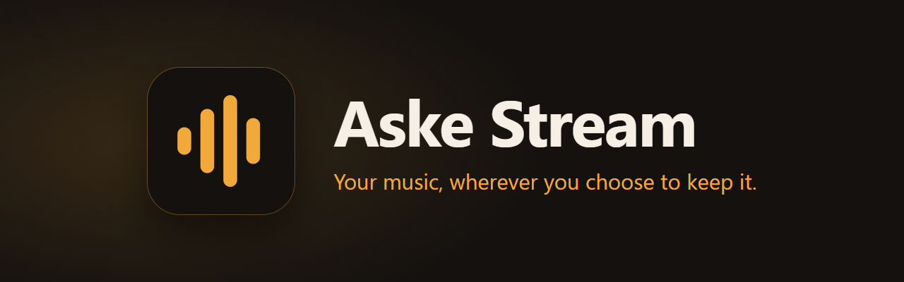

**Zure musika, zuk aukeratzen duzun lekuan.**

[English](README.md) · [Español](README.es.md) · Euskara

[](https://github.com/Ando144/aske-stream/actions/workflows/ci.yml)
[](https://github.com/Ando144/aske-stream/actions/workflows/android.yml)
[](https://github.com/Ando144/aske-stream/releases/latest)
[](LICENSE)
[](https://github.com/Ando144/aske-stream/releases)
[](docs/development.md)
[](tsconfig.base.json)

**[Deskargatu Android aplikazioa](https://github.com/Ando144/aske-stream/releases/latest)** ·
[Dokumentazioa](docs/README.md) ·
[Arkitektura](docs/architecture.md) ·
[Nola lagundu](CONTRIBUTING.md)

</div>

<table align="center">
  <tr>
    <td align="center">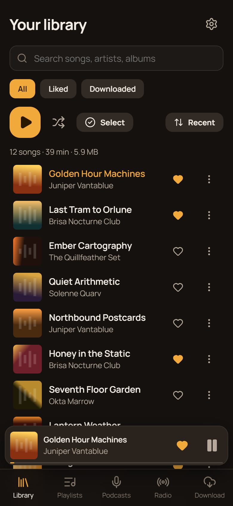<br /><sub>Zure abestiak</sub></td>
    <td align="center">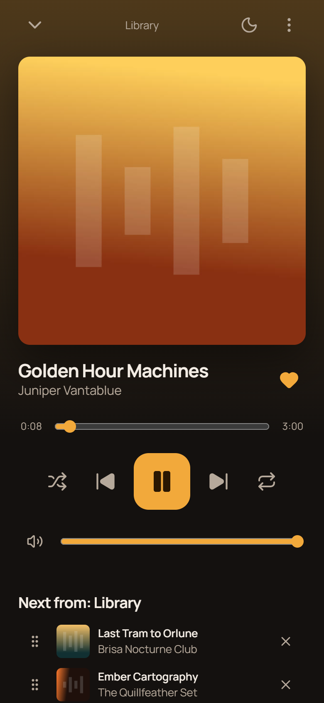<br /><sub>Erreproduzigailua eta ilara</sub></td>
    <td align="center">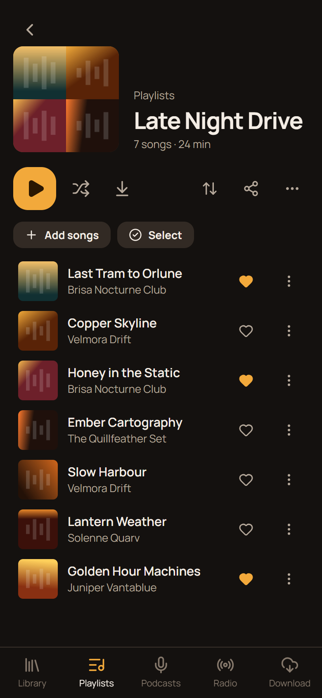<br /><sub>Zerrendak</sub></td>
    <td align="center">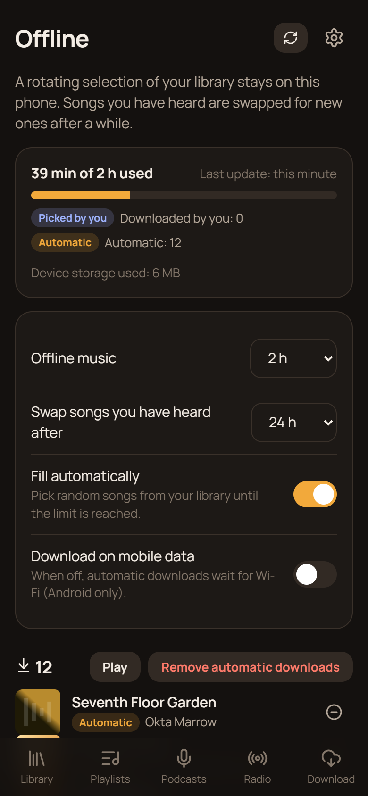<br /><sub>Konexiorik gabeko musika</sub></td>
  </tr>
  <tr>
    <td align="center">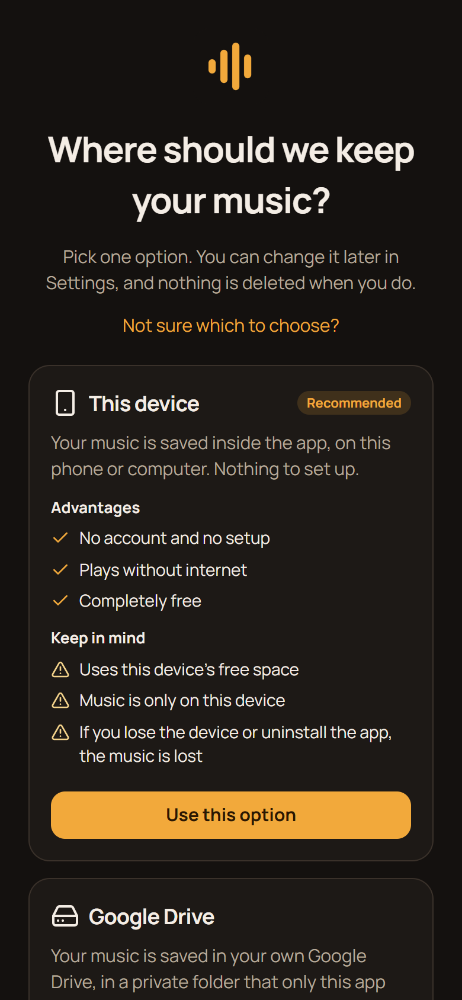<br /><sub>Zuk aukeratzen duzu non gorde</sub></td>
    <td align="center">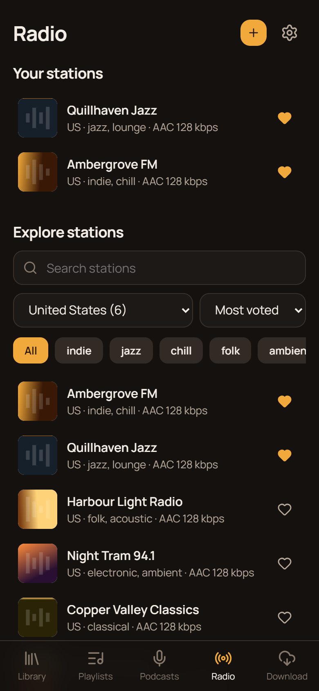<br /><sub>Zuzeneko irratia</sub></td>
    <td align="center">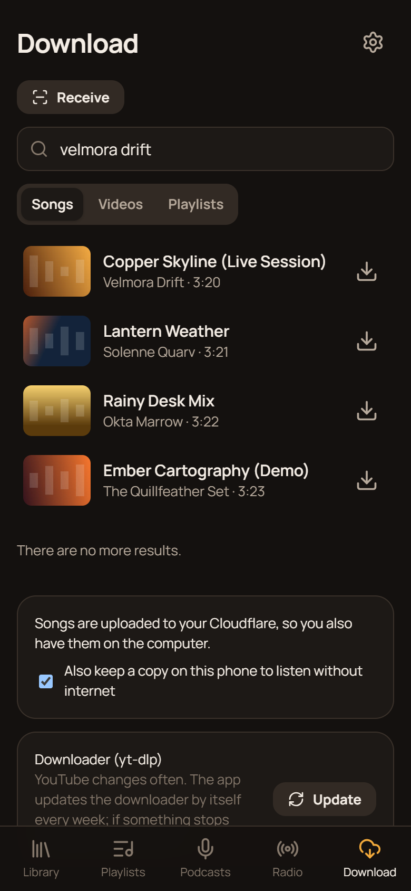<br /><sub>Deskargatu (Android)</sub></td>
    <td align="center">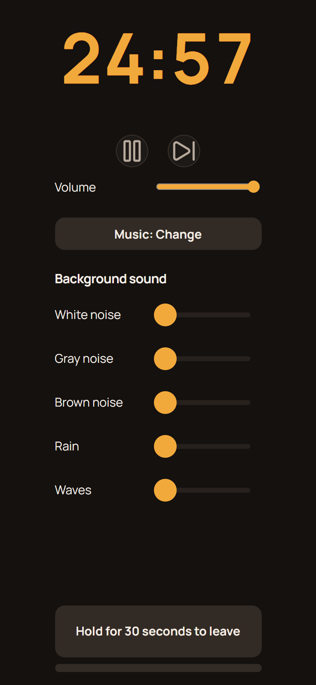<br /><sub>Ikasketa modua (Android)</sub></td>
  </tr>
</table>

<p align="center">
  
  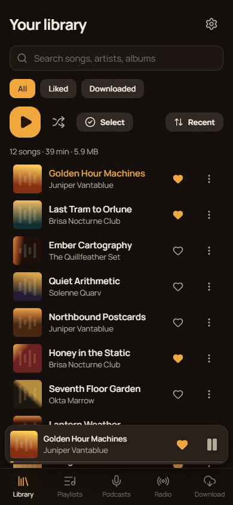
</p>

<p align="center">
  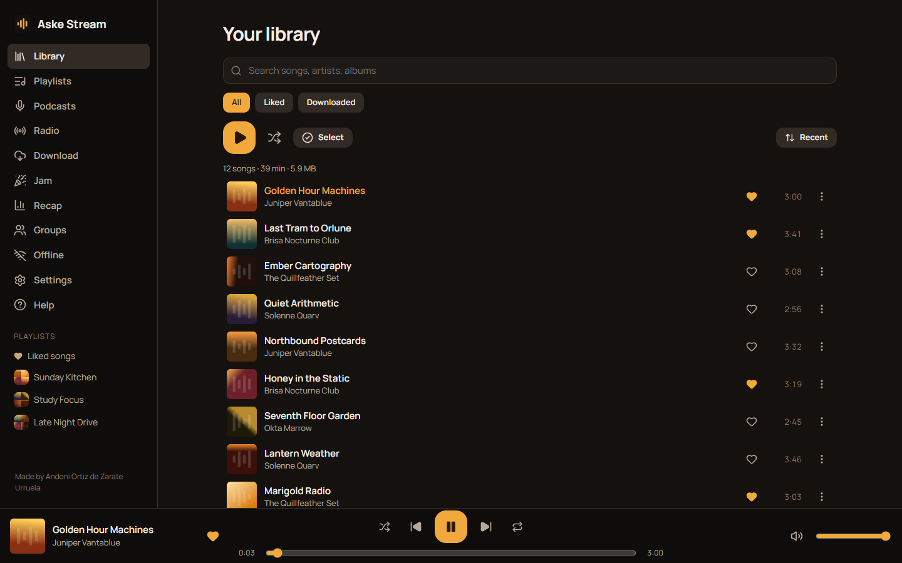
</p>

<p align="center"><sub>Irudietako musika, artista eta irrati guztiak asmatuak dira. Pantaila-argazkiek aplikazioa ingelesez erakusten dute.</sub></p>

## Zer da

Aske Stream kode irekiko musika-aplikazio bat da, Spotifyren antzekoa, ezagutza teknikorik ez duten
lagunentzat egina. Ez dago musika-zerbitzu zentralik: bakoitzak aukeratzen du bere musika non
gordeko den, eta geroago alda dezake ezer ezabatu gabe. Nabigatzailean dabil, instala daitekeen web
aplikazio gisa, eta Android-en, aplikaziotik bertatik eguneratzen den APK fitxategi batekin.

|                          | Gailu hau                              | Google Drive                                 | Zure Cloudflare                                       |
| ------------------------ | -------------------------------------- | -------------------------------------------- | ----------------------------------------------------- |
| Prestaketa               | Bat ere ez                             | Google-ekin saioa hasi                       | Gidatua, 10 minutu inguru                             |
| Prezioa eta lekua        | Doan; gailuaren leku librea            | 15 GB doan, Gmail eta Argazkiekin batera     | Doako plana, 10 GB; Cloudflare-k txartela eskatzen du |
| Ordenagailuan entzun     | Musika gehitu duzun lekuan geratzen da | Bai                                          | Bai                                                   |
| Mugikorra galtzen baduzu | Bertan gordetako musika galtzen da     | Salbu dago                                   | Salbu dago                                            |
| Internetik gabe          | Dena entzuten da                       | Konexiorik gabe entzuteko gordetako abestiak | Konexiorik gabe entzuteko gordetako abestiak          |

Abesti arrunt batek 4 MB inguru hartzen ditu; beraz, 10 GB-tan 2.500 abesti inguru sartzen dira.

## Zer egin dezakezu

### Liburutegia eta erreproduzigailua

- Bilatu, ordenatu, gogoko abestiak markatu eta zerrendak sortu, karpetekin, azal pertsonalekin,
  goian finkatuta edo bi zerrenda batuta.
- Ilara, dena errepikatu baino lehen abesti guztiak jartzen dituen ausazko modua, errepikatzea eta
  lo egiteko tenporizadorea.
- Irristatu hatzarekin abestia aldatzeko edo ilarara gehitzeko.
- «Gailu hau» erabilita, inportatu dagoeneko dituzun musika-fitxategiak. Eta kopiatu zure musika
  biltegi batetik bestera.

### Konexiorik gabeko musika

- Google Drive edo Cloudflare erabilita, aplikazioak zure musikaren hautaketa bat gordetzen du
  gailuan, entzuteko orduetan neurtua.
- Entzundako abestiak berriekin aldatzen dira. Abesti bat ordezkoa iritsi denean bakarrik kentzen
  da.
- Zuk deskargatutakoak ez dira inoiz aldatzen.

### Irratia eta podcastak

- Zuzeneko irratia [Radio Browser](https://www.radio-browser.info) direktorio irekitik, herrialde
  eta estiloaren arabera, eta zuk gehitzen dituzun helbideak ere bai.
- Podcastak sailka multzokatuta, utzi zenuen lekutik jarraituta, abiadura aldatzeko aukerarekin eta
  15 s atzera edo 30 s aurrera egiteko botoiekin.

### Android-en

- Pantaila itzalita ere entzuten da, kontrolak jakinarazpenean eta blokeo-pantailan dituela.
- Bilatu YouTuben eta deskargatu abestiak edo zerrenda osoak mugikorrean bertan.
- Partekatu YouTube edo YouTube Music-eko esteka bat zuzenean Aske Stream-era.
- Eguneratu aplikazioa barrutik.

YouTubetik deskargatzea erabilera pertsonalerako da. Errespetatu egile-eskubideak eta YouTuben
erabilera-baldintzak, deskargatzeak haiek urra ditzake eta: deskargatzen duzunaren erantzule zu
zara.

### Lagunekin

[Aske Hub](docs/hub.md) zerbitzari txiki partekatuari esker dabiltza; ez du inoiz musikarik
gordetzen.

- **Partekatutako zerrendak:** esteka labur bat bidaltzen duzu, eta zure lagunaren aplikazioak bere
  kabuz deskargatzen ditu abestiak.
- **Jam:** lagunak QR kode batekin sartzen dira, nabigatzailetik ere bai, abestiak gehitzen eta
  saltatzen dituzte. Musika antolatzailearen mugikorrean entzuten da.
- **Lagunen taldeak:** zerrendak eta Jam-ak partekatu, eta entzuten duzuena alderatu, zuk
  aktibatzen baduzu bakarrik.
- **Bidali mugikorrera:** aukeratu abestiak ordenagailuan edo beste mugikor batean, eta jaso behin
  bakarrik balio duen kode batekin.

### Ikasketa modua eta laguntza

- **Ikasketa modua** (Android): aplikazioa pantailan finkatzen du zuk aukeratutako minutuetan,
  musika lasaiarekin, hondoko soinuekin eta amaieran kanpaitxo batekin.
- **Recap:** zure hileko eta urteko laburpena, onartu arte itzalita eta zure gailuan gordeta.
- Lehen urratsen gida, aholku bat pantaila bakoitzean eta bilatzailea duen laguntza-gunea,
  **euskaraz, gaztelaniaz eta ingelesez**.

### Jakin beharrekoa

- Ez dago iPhone-rako aplikaziorik; web bertsioa erabiltzen da nabigatzailean.
- Konexiorik gabeko hautaketa aplikazioa irekita edo musika jotzen ari denean berritzen da, ez
  itxita dagoenean.

## Nola hasi

### Android aplikazioa instalatu

Deskargatu APKa [azken bertsiotik](https://github.com/Ando144/aske-stream/releases/latest) eta
ireki mugikorrean. Androidek jatorri horretatik instalatzeko baimena eskatuko dizu. Izenean `armv7`
duen fitxategia 32 biteko mugikor zaharretarako bakarrik da.

### Zure Cloudflare erabili

Android aplikazioak mugikorretik bertatik prestatzen duen laguntzaile bat du. Ordenagailutik,
jarraitu [instalazio-gidari](docs/deployment.md) (ingelesez).

### Garapena zure ordenagailuan

Node.js 22.12 edo berriagoarekin:

```bash
git clone https://github.com/Ando144/aske-stream.git
cd aske-stream
npm ci
npm run db:migrate:local
npm run dev
```

Xehetasunak [garapen-gidan](docs/development.md) (ingelesez).

## Ingeniaritza

Laburpen motza; estekatutako dokumentuak ingelesez daude.

- **React eta TypeScript aplikazio bakarra** webgunerako eta Android-erako (Capacitor eta plugin
  propioak).
- **Hiru biltegi interfaze berarekin:** gailua, Google Drive eta norberaren Cloudflare (Worker, D1
  eta R2). [Erabakia](docs/adr/0006-storage-homes.md).
- **Hub bereizi bat** (Worker, D1 eta Durable Object) partekatzeko, musikarik gorde gabe.
- **Konpondutako arazoak:** audioa bigarren planoan, konexiorik gabeko txandakatzea, zerbitzaririk
  gabeko sinkronizazioa Drive bidez eta deskargak modu seguruan bertan behera uztea.
- **Kalitatea:** proba unitarioak eta muturretik muturrerakoak, integrazio jarraitua, estaldura,
  sekretuen bilaketa eta Dependabot.

[Arkitektura](docs/architecture.md) · [Erabakiak](docs/adr/README.md) ·
[Probak](docs/testing.md) · [Dokumentazio osoa](docs/README.md)

## Laguntzea, segurtasuna eta pribatutasuna

Irakurri [laguntzeko gida](CONTRIBUTING.md) eta [jokabide-kodea](CODE_OF_CONDUCT.md).
Segurtasun-akatsak [segurtasun-politikan](SECURITY.md) adierazi bezala jakinarazi, ez arazo publiko
batean. Ez dago iragarkirik ez jarraipenik;
[pribatutasun-politikak](docs/PRIVACY.md) azaltzen du.

## Egilea

**Andoni Ortiz de Zarate Urruela** ([@Ando144](https://github.com/Ando144)) egileak diseinatu eta
garatua.

## Lizentzia

[MIT](LICENSE). Gehitzen duzun musika zure erantzukizuna da: erabili zurea den edo erabiltzeko
baimena duzun edukia bakarrik.
