<div align="center">

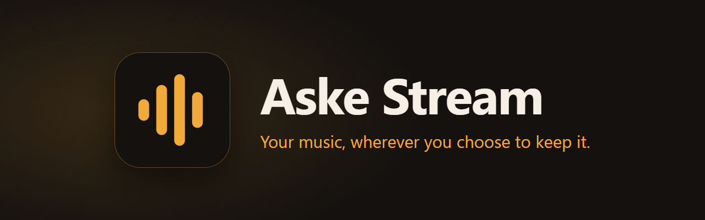

**Your music, wherever you choose to keep it.**

English · [Español](README.es.md) · [Euskara](README.eu.md)

[](https://github.com/Ando144/aske-stream/actions/workflows/ci.yml)
[](https://github.com/Ando144/aske-stream/actions/workflows/android.yml)
[](https://github.com/Ando144/aske-stream/releases/latest)
[](LICENSE)
[](https://github.com/Ando144/aske-stream/releases)
[](docs/development.md)
[](tsconfig.base.json)

**[Download the Android app](https://github.com/Ando144/aske-stream/releases/latest)** ·
[Documentation](docs/README.md) ·
[Architecture](docs/architecture.md) ·
[Contributing](CONTRIBUTING.md)

</div>

<table align="center">
  <tr>
    <td align="center">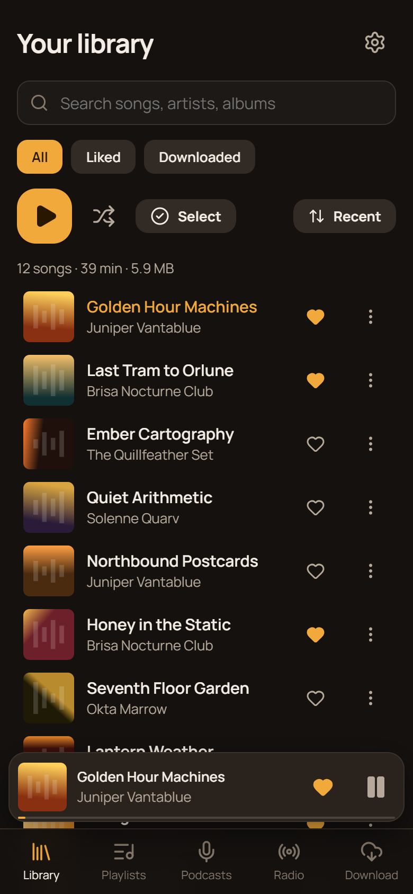<br /><sub>Your songs</sub></td>
    <td align="center">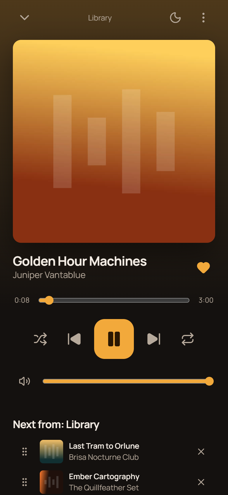<br /><sub>Player and queue</sub></td>
    <td align="center">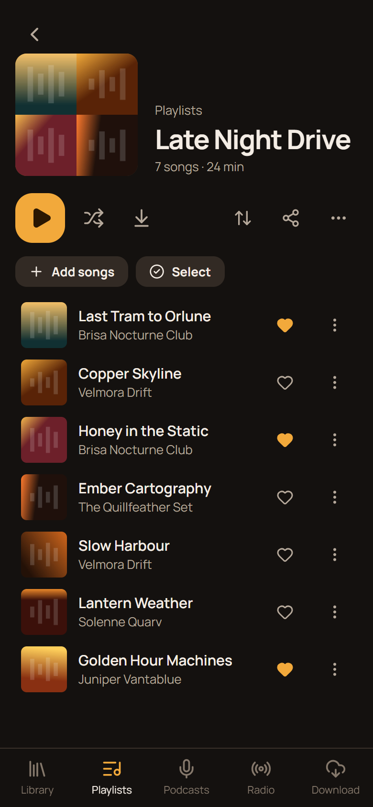<br /><sub>Playlists</sub></td>
    <td align="center">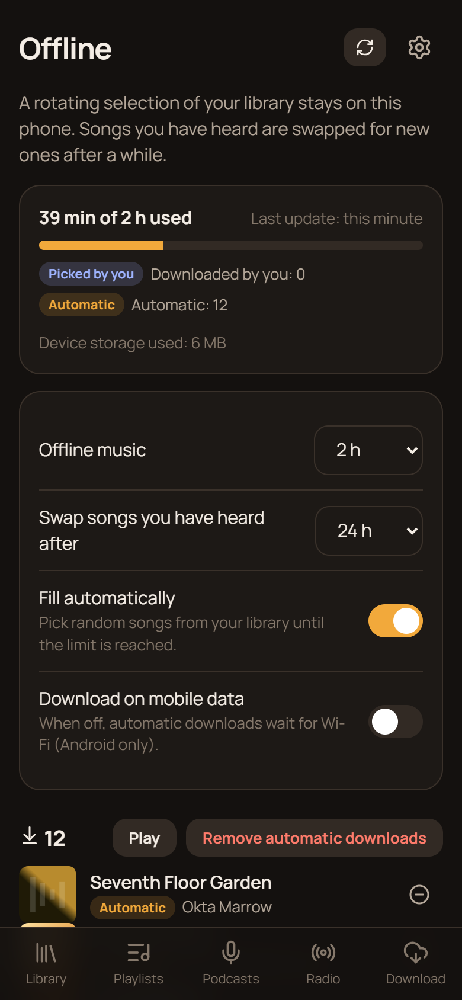<br /><sub>Offline music</sub></td>
  </tr>
  <tr>
    <td align="center">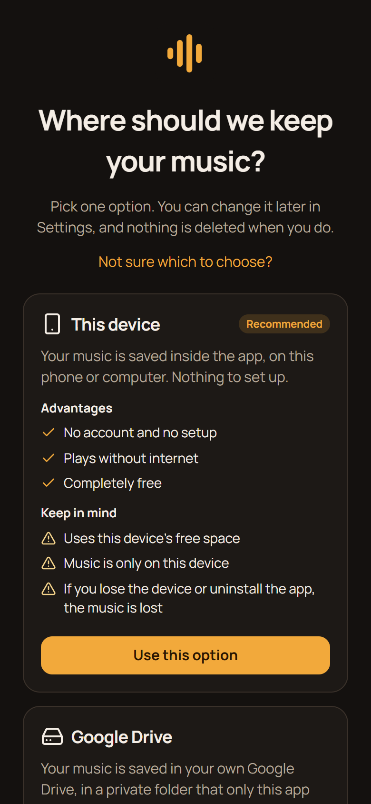<br /><sub>You choose the storage</sub></td>
    <td align="center">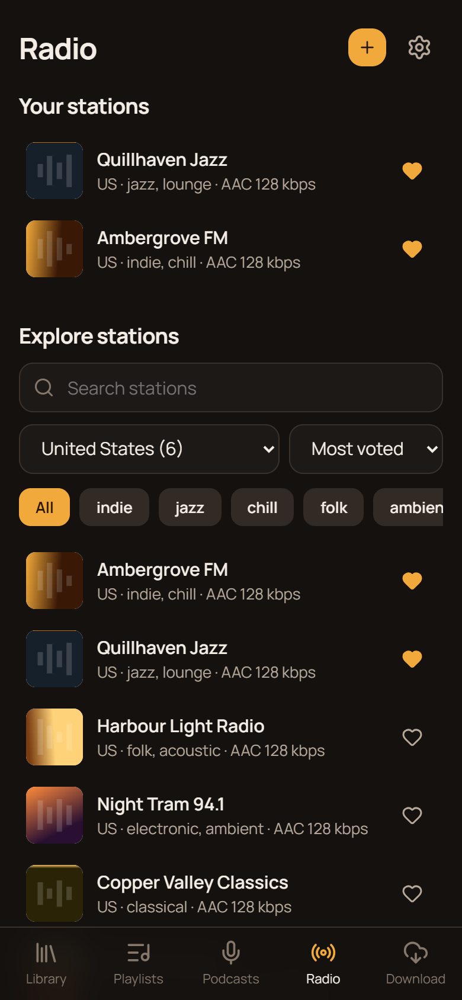<br /><sub>Live radio</sub></td>
    <td align="center">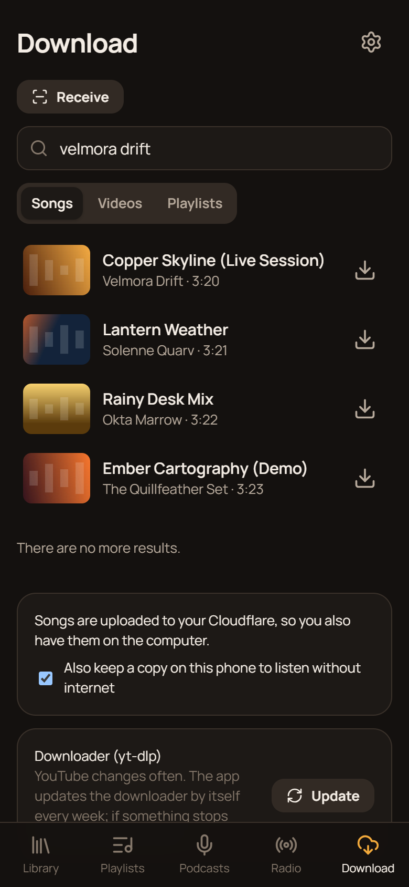<br /><sub>Download (Android)</sub></td>
    <td align="center">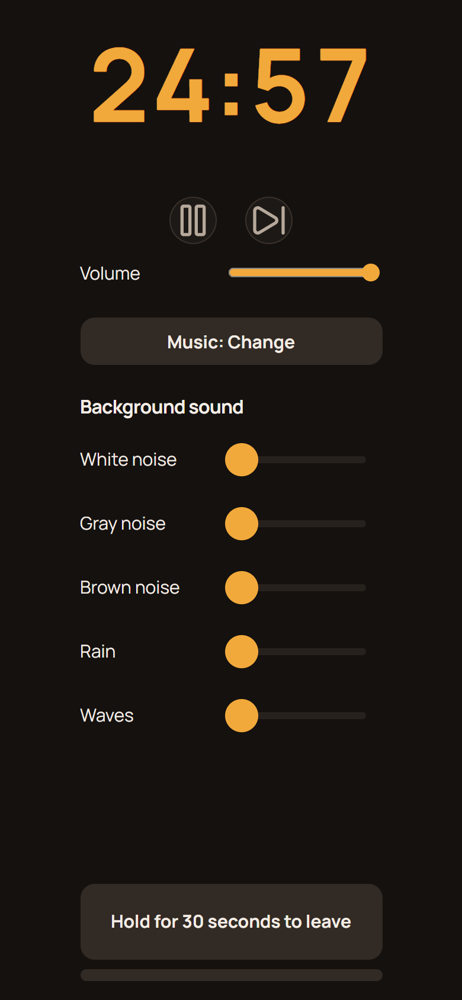<br /><sub>Study mode (Android)</sub></td>
  </tr>
</table>

<p align="center">
  
  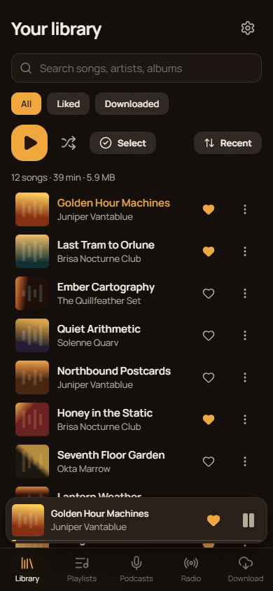
</p>

<p align="center">
  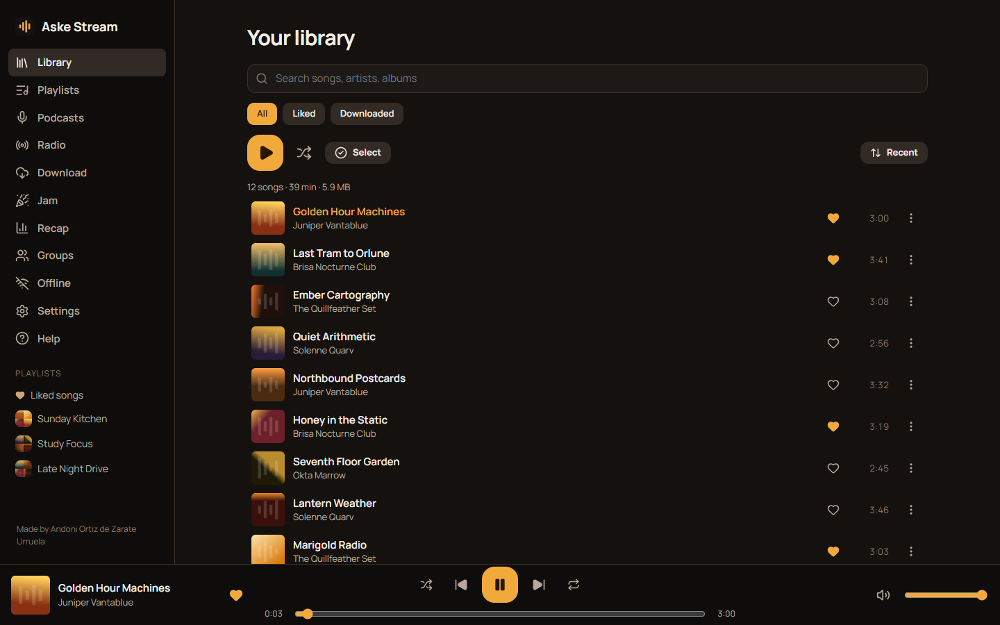
</p>

<p align="center"><sub>All the music, artists and stations in these pictures are invented.</sub></p>

## What it is

Aske Stream is an open-source music app in the style of Spotify, made for friends with no technical
background. There is no central music service: each person chooses where their own music is kept,
and can change that choice later without anything being deleted. It runs in the browser as an
installable web app and on Android as an APK that updates itself.

_Aske_ means "free" in Basque.

|                      | This device                        | Google Drive                          | Your own Cloudflare                          |
| -------------------- | ---------------------------------- | ------------------------------------- | -------------------------------------------- |
| Setup                | None                               | Sign in with Google                   | Guided, about 10 minutes                     |
| Cost and space       | Free; the free space of the device | 15 GB free, shared with Gmail, Photos | Free plan, 10 GB; Cloudflare asks for a card |
| Listen on a computer | The music stays where you added it | Yes                                   | Yes                                          |
| If you lose a phone  | The music kept on it is lost       | Kept                                  | Kept                                         |
| Without internet     | Everything plays                   | The songs saved for offline listening | The songs saved for offline listening        |

An average song takes about 4 MB, so 10 GB holds around 2,500 songs.

## Features

### Library and player

- Search, sorting, liked songs and playlists, with folders, custom covers, pinning and merging.
- Queue, shuffle that plays everything once before repeating, repeat and a sleep timer.
- Swipe to go to the next song or to add a song to the queue.
- On "This device", import the audio files you already have. Copy your music from one storage to
  another.

### Offline listening

- With Google Drive or Cloudflare, the app keeps a selection of your music on the device, measured
  in hours of listening.
- Songs you have already heard are swapped for new ones. A song is only removed once its
  replacement has arrived.
- Songs and playlists you download yourself are never rotated.

### Radio and podcasts

- Live radio from the open [Radio Browser](https://www.radio-browser.info) directory, filtered by
  country and genre, plus your own stream addresses.
- Podcasts grouped by series, resuming where you left off, with playback speed and 15 s back or
  30 s forward.

### On Android

- Plays with the screen off, with controls in the notification and on the lock screen.
- Search YouTube and download songs or whole playlists on the phone itself.
- Share a link from YouTube or YouTube Music straight to Aske Stream.
- Updates from inside the app.

Downloading from YouTube is meant for personal use. Respect copyright and YouTube's Terms of
Service, which downloading may breach: you are responsible for what you download.

### With friends

These use the [Aske Hub](docs/hub.md), a small shared server that never stores music.

- **Shared playlists:** send a short link; your friend's app downloads the songs on its own.
- **Jam:** friends join with a QR code, also from a browser, add songs and skip them. The music
  plays on the host's phone.
- **Friend groups:** share playlists and Jams, and compare listening only if you switch it on.
- **Send to phone:** pick songs on a computer or another phone and receive them with a one-time code.

### Study mode and help

- **Study mode** (Android): pins the app for the minutes you choose, with calm music, background
  sounds and a chime at the end.
- **Recap:** your monthly and yearly listening, off until you accept it and stored on your device.
- First steps guide, a tip on each screen and a searchable help centre, all in **English, Spanish
  and Basque**.

### Good to know

- There is no iPhone app; the web app works in the browser.
- The offline selection is renewed while the app is open or playing, not while it is closed.

## Get started

### Install the Android app

Download the APK from the [latest release](https://github.com/Ando144/aske-stream/releases/latest)
and open it on your phone. Android asks you to allow installing from that source. The file named
`armv7` is only for old 32-bit phones.

### Use your own Cloudflare

The Android app has a guided setup that does it from the phone. From a computer, follow the
[deployment guide](docs/deployment.md).

### Develop locally

With Node.js 22.12 or newer:

```bash
git clone https://github.com/Ando144/aske-stream.git
cd aske-stream
npm ci
npm run db:migrate:local
npm run dev
```

Everything runs on your computer and no Cloudflare account is needed. See the
[development guide](docs/development.md).

## Engineering

### Overview

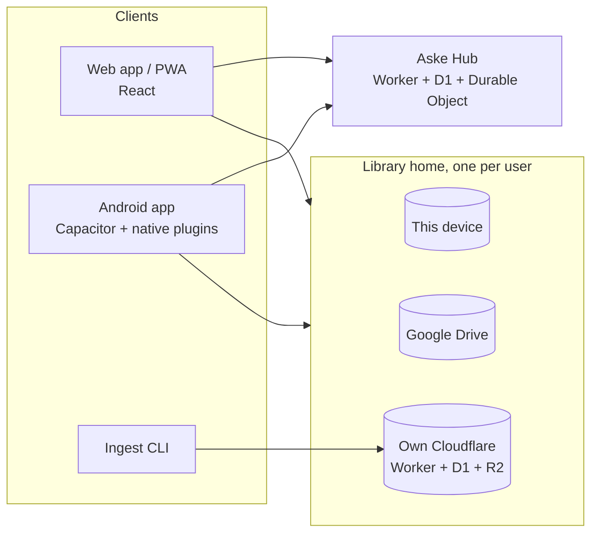

### Stack

| Area       | Technology                                                        |
| ---------- | ----------------------------------------------------------------- |
| App        | React 19, Vite 8, TypeScript (strict), zustand, wouter, IndexedDB |
| Own server | Cloudflare Workers, Hono, zod, D1 (SQLite), R2                    |
| Shared Hub | A separate Worker with D1 and a Durable Object over WebSocket     |
| Android    | Capacitor 8, our own Java plugins, youtubedl-android              |
| Tooling    | npm workspaces, Prettier, Vitest, Playwright, GitHub Actions      |

### Key decisions

| Decision                                                                                  | Why it matters                                  |
| ----------------------------------------------------------------------------------------- | ----------------------------------------------- |
| [One home, many destinations](docs/adr/0006-storage-homes.md)                             | One source of truth without a sync engine       |
| [Google Drive with `drive.file`](docs/adr/0007-google-drive-home.md)                      | The app only sees the files it created          |
| [WebView playback with native plugins](docs/adr/0009-capacitor-webview-native-plugins.md) | One player for web and Android                  |
| [A Hub that never stores music](docs/adr/0010-aske-hub-and-jam.md)                        | Social features without hosting anyone's files  |
| [Single-owner pairing](docs/adr/0003-single-owner-auth.md)                                | No accounts or passwords, and nothing is public |
| [Opt-in statistics](docs/adr/0013-opt-in-listening-stats.md)                              | Listening history only with explicit consent    |

All of them are in the [decision records](docs/adr/README.md).

### Engineering challenges solved

- **Audio in the background inside a WebView:** a native media session and foreground service, with
  wake locks held only while music plays ([Android notes](docs/android.md)).
- **Offline rotation that never shrinks your music:** a pure, unit-tested planner swaps heard songs
  only as replacements arrive ([offline cache](docs/offline-cache.md)).
- **Syncing through Google Drive without a server:** each device merges one `library.json`, where
  the newest change wins and deletions are final ([ADR 0007](docs/adr/0007-google-drive-home.md)).
- **Safe cancellation:** every upload has its own id, so cancelling does not delete a copy added by
  another device, with one documented exception for old servers
  ([ADR 0012](docs/adr/0012-upload-ids-safe-cancel.md)).
- **Downloads where they work:** yt-dlp runs on the phone, on the user's own connection, because
  YouTube blocks datacenter addresses ([ADR 0008](docs/adr/0008-youtube-download-on-the-phone.md)).
- **No quality lost:** Opus audio from YouTube is stored without re-encoding
  ([ADR 0004](docs/adr/0004-opus-remux.md)).
- **Staying within the free plan:** a 10 GB budget, with uploads refused at 95 % (`507
storage_full`) ([limits](docs/architecture.md#limits)).

### Quality

- Unit tests in every workspace, including checks that the three languages are complete.
- An end-to-end smoke test against a real local Worker, and browser tests with Playwright.
- CI checks formatting, types, tests, documentation links and the build, reports coverage and scans
  for secrets with gitleaks.
- [Dependabot](.github/dependabot.yml) proposes dependency updates every month.

Details in the [testing guide](docs/testing.md).

### Project structure

```
apps/web          Web app and PWA
apps/api          Each user's own Cloudflare Worker
apps/hub          Aske Hub (shared playlists, groups, Jam)
apps/mobile       Android app and native plugins
packages/shared   Shared types, limits and YouTube parser
tools/ingest      CLI to upload music to Cloudflare
scripts           Development, setup, tests and documentation
docs              Documentation
```

## Documentation

Start at the [documentation index](docs/README.md): [deployment](docs/deployment.md),
[architecture](docs/architecture.md), [Worker API](docs/api/worker.md),
[Hub API](docs/api/hub.md), [ingest CLI](docs/ingest.md) and the [changelog](CHANGELOG.md).

## Contributing and security

Ideas and fixes are welcome: read [CONTRIBUTING.md](CONTRIBUTING.md) and the
[code of conduct](CODE_OF_CONDUCT.md). To report a vulnerability, follow the
[security policy](SECURITY.md) instead of opening a public issue.

## Privacy

No ads and no tracking. What the app stores and which services it talks to is explained in the
[privacy policy](docs/PRIVACY.md).

## Author

Designed and built by **Andoni Ortiz de Zarate Urruela**
([@Ando144](https://github.com/Ando144)).

## License

[MIT](LICENSE). The music you add is your responsibility: only use content you own or are allowed
to use.
