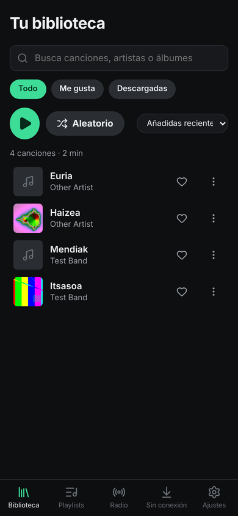
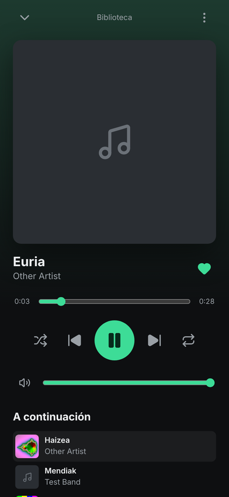
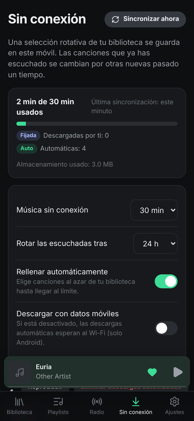
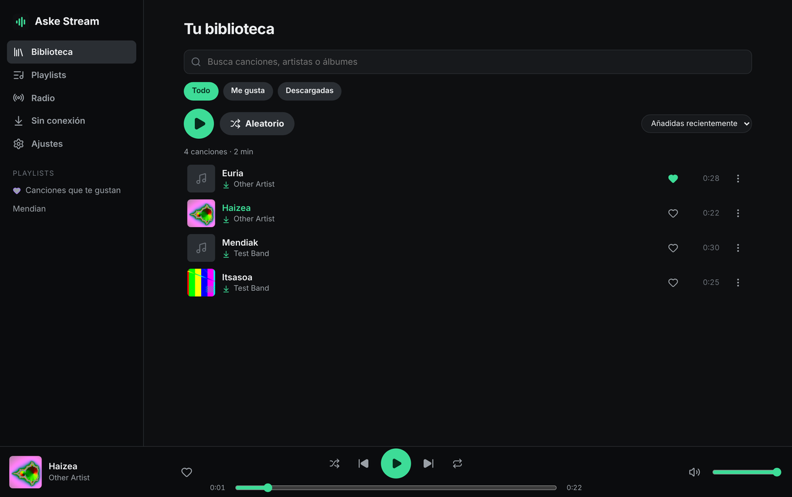
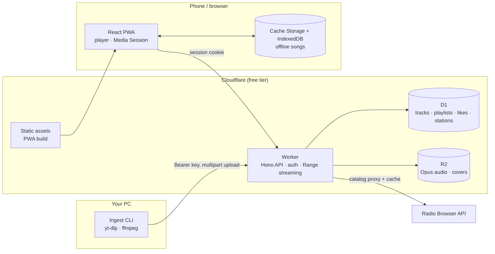

<div align="center">


# Aske Stream

**Your own Spotify-style music cloud.** Bring your own music, stream it from Cloudflare R2,
organise it in playlists, listen to live radio, and keep a self-refreshing offline selection on your phone.

[](https://github.com/Ando144/aske-stream/actions/workflows/ci.yml)


_aske_ means “free” in Basque — free as in open source, and free to run on Cloudflare's free tier.

</div>

<p align="center">
  
  
  
</p>
<p align="center"></p>

## Features

- **Streaming** of Opus audio with instant seeking (HTTP Range requests straight from R2).
- **Library** with search (accent-insensitive), sorting, **likes** (“Liked songs”) and **playlists**: create, rename, delete, add/remove songs, play next, add to queue.
- **Player**: play/pause, next/previous, seek bar, volume, true Fisher–Yates **shuffle**, repeat all / one, queue view, state restored after reopening the app.
- **Background playback on Android** with lock-screen and notification controls (Media Session API).
- **Smart offline cache**: pin songs or whole playlists, and let the app fill a **minutes-based quota** with random songs. Songs you've heard are **rotated** for fresh ones after a configurable time — swapped, never dropped, so you never end up with less music offline.
- **Live radio**: browse and search tens of thousands of stations from the open [Radio Browser](https://www.radio-browser.info) directory by country and genre, **like** stations to keep them on top, or add your own stream URLs. HLS streams supported.
- **Installable PWA**, works offline, available in **Basque, Spanish and English**.
- **Ingest CLI**: turn YouTube links/playlists or local files (MP3, FLAC, AAC…) into tagged Opus tracks with cover art and upload them in one command.
- **Single-owner security model**: no accounts or passwords, but nothing is public — devices are paired once with a secret key.

## Architecture



| Layer    | Tech                                                | Why                                                                                  |
| -------- | --------------------------------------------------- | ------------------------------------------------------------------------------------ |
| Client   | React 19, Vite, TypeScript, Zustand, Workbox        | Installable PWA with background audio on Android and offline support                 |
| API      | Cloudflare Workers + [Hono](https://hono.dev) + Zod | Same origin as the app, global edge, free tier                                       |
| Metadata | Cloudflare D1 (SQLite)                              | Relational data (playlists, likes) with transactions; ETag-based sync                |
| Media    | Cloudflare R2                                       | 10 GB free, **no egress fees**, private bucket only reachable through the Worker     |
| Audio    | Ogg Opus                                            | Best quality per byte; YouTube's own format, so it is stored **without re-encoding** |
| Ingest   | Node CLI + yt-dlp + ffmpeg                          | Runs on a residential IP — YouTube blocks datacenter IPs                             |

More detail in [docs/architecture.md](docs/architecture.md) and the decision records in [docs/adr](docs/adr).

## Quick start (local, 2 minutes)

Requirements: Node.js 22+, and ffmpeg if you want to ingest music.

```bash
git clone https://github.com/Ando144/aske-stream.git
cd aske-stream
npm install
npm run dev
```

Open <http://localhost:5173/#key=local-dev-access-key-change-me-0123456789>. Everything (API, D1, R2) runs locally through `wrangler dev`; nothing touches your Cloudflare account.

Add some music to the local instance:

```bash
cp .env.example .env      # set ASKE_URL=http://127.0.0.1:8787 and the dev key above
npm run ingest -- "C:\Users\me\Music\Album"                    # local files
npm run ingest -- "https://www.youtube.com/watch?v=..."        # needs yt-dlp
```

## Deploy your own instance

```bash
npx wrangler login
npm run cf:setup
```

`cf:setup` creates the D1 database and R2 bucket in **your** account, applies the migrations, deploys, generates an access key and prints a one-time pairing link. Full walkthrough (Windows-friendly, with troubleshooting): **[docs/deployment.md](docs/deployment.md)**.

## Project structure

```
aske-stream/
├─ apps/
│  ├─ api/              Cloudflare Worker (Hono): routes, auth, R2 streaming, D1 migrations
│  ├─ web/              React PWA: views, player engine, offline engine, i18n (eu/es/en)
│  └─ mobile/           Android app: the same web app in Capacitor + native plugins
├─ packages/shared/     Types shared by API, web and CLI
├─ tools/ingest/        CLI: YouTube / files → Opus → upload
├─ scripts/             dev, cf-setup, smoke (E2E) and icon scripts
├─ docs/                Architecture, deployment, offline cache, ingest, ADRs
└─ .github/workflows/   CI (format, typecheck, tests, build, E2E, secret scan), deploy, signed APK releases
```

## Quality

```bash
npm run check      # prettier + typecheck + unit tests + production build
npm run test:e2e   # boots a real Worker with local D1/R2 and exercises the whole API
```

- Unit tests: offline rotation planner, shuffle/queue logic, session tokens, Range handling, metadata cleanup, translation completeness.
- End-to-end: pairing, uploads, duplicate detection, ETag sync, Range seeking, likes, playlists, stations, deletion.
- CI runs everything on each push plus a [gitleaks](https://github.com/gitleaks/gitleaks) secret scan.

## Configuration & secrets

| Name                                                                 | Where                                             | Purpose                                                    |
| -------------------------------------------------------------------- | ------------------------------------------------- | ---------------------------------------------------------- |
| `ACCESS_KEY`                                                         | Worker secret (`wrangler secret put`)             | The single owner key. Rotate it to log every device out.   |
| `ASKE_URL`, `ASKE_ACCESS_KEY`                                        | `.env` (git-ignored)                              | Used by the ingest CLI                                     |
| `database_id`                                                        | `apps/api/wrangler.jsonc`                         | Your D1 id (not a secret)                                  |
| `CLOUDFLARE_API_TOKEN`, `CLOUDFLARE_ACCOUNT_ID`                      | GitHub secrets (optional)                         | Only for the manual deploy workflow                        |
| `ANDROID_KEYSTORE_BASE64`, `ANDROID_*_PASSWORD`, `ANDROID_KEY_ALIAS` | GitHub secrets; `.secrets/` locally (git-ignored) | Signs the Android APK ([docs/android.md](docs/android.md)) |

No credentials ever live in the repository: the bucket has no public access and no S3 keys exist — the Worker reaches R2 through a binding.

## Limitations

- **iOS**: background audio in installed web apps is unreliable on iOS 26 (WebKit bugs). The app targets Android and desktop browsers.
- **Offline rotation** runs while the app is open or playing (on start, on reconnect, every 30 min, after songs). Browsers do not allow a PWA to download in the background when closed; in the Android app this is planned (see [docs/android.md](docs/android.md)).
- **YouTube ingestion** relies on yt-dlp, which occasionally breaks until updated (`yt-dlp -U`). See [docs/ingest.md](docs/ingest.md), including the legal note.

## Roadmap

See [docs/v2/architecture.md](docs/v2/architecture.md) for the v2 plan (Android app ✅, YouTube
downloads in the app, Google Drive, guided setup, shared playlists and Jams).

## License

[MIT](LICENSE). Music you add is your responsibility — only upload content you own or are licensed to use.
