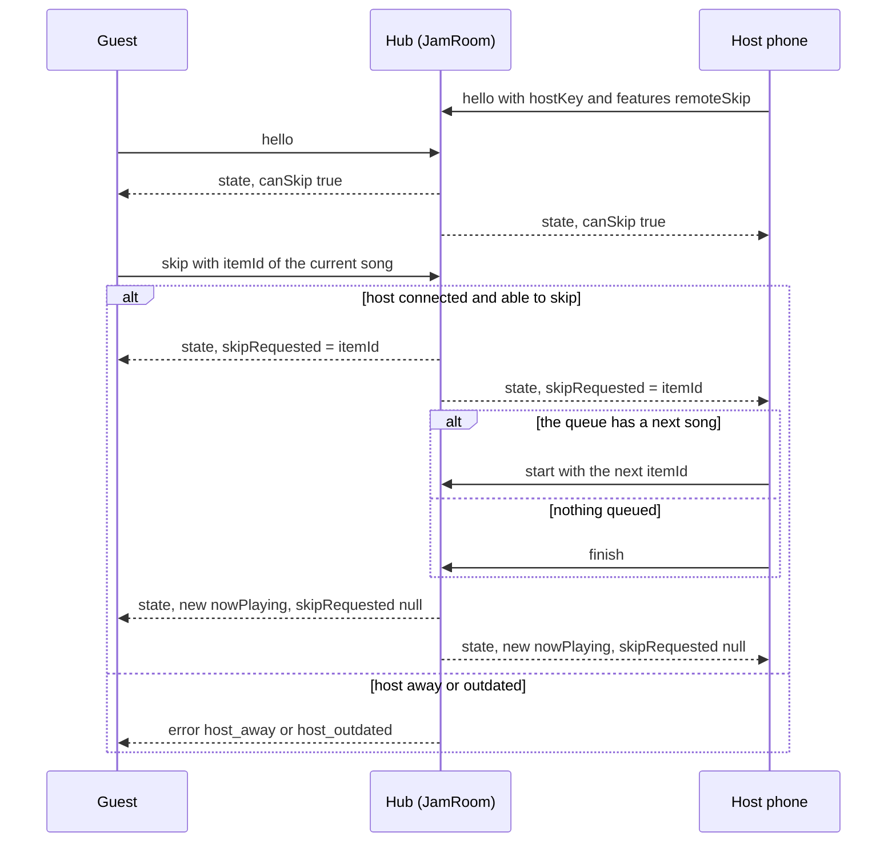
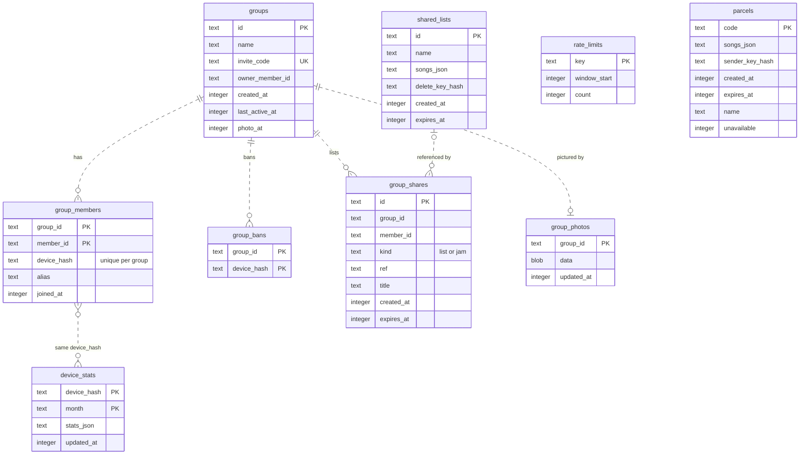

# Hub API reference

The Hub in `apps/hub` is a single Worker shared by all users. It handles shared playlist links,
"Send to phone" parcels, YouTube search and playlist reading, friend groups and Jams. It never
stores music. What it keeps, and how to deploy it, is described in [Aske Hub](../hub.md). The
private library API is in the [Worker API reference](worker.md).

## Base URL, access and conventions

- The base URL is the address of the Hub deployment (`http://localhost:8788` in local development).
  The apps take it from `HUB_URL` in `apps/web/src/config.ts`. All endpoints are under `/hub/v1`;
  every path outside `/hub` serves the web app.
- There are no accounts. Some endpoints ask for a secret that the Hub returned or that the device
  generated:

| Header         | Used by               | Value                                               |
| -------------- | --------------------- | --------------------------------------------------- |
| `X-Delete-Key` | Shared lists, parcels | `deleteKey` or `senderKey` returned on creation     |
| `X-Device-Key` | Every groups endpoint | 64 lowercase hex characters generated by the device |

The Hub only stores hashes of these keys (and of the Jam `hostKey`).

- CORS allows any origin, the methods `GET`, `POST`, `PUT`, `DELETE` and `OPTIONS`, and the headers
  `Content-Type`, `X-Delete-Key` and `X-Device-Key`.
- Responses carry `Cache-Control: no-store` unless an endpoint sets its own value.
- Timestamps are Unix epoch milliseconds.
- Short codes and ids use the alphabet `23456789ABCDEFGHJKLMNPQRSTUVWXYZ`.

### Error format

```json
{ "error": "not_found", "message": "List not found" }
```

| Status | `error`                | When                                                        |
| ------ | ---------------------- | ----------------------------------------------------------- |
| 400    | `invalid_request`      | Invalid body, query, header or upload                       |
| 403    | `invalid_request`      | Wrong delete key or sender key                              |
| 403    | `not_member`           | The device is not in the group                              |
| 403    | `not_owner`            | Only the creator (or the author of a share) may do it       |
| 403    | `kicked`               | The device was removed from the group                       |
| 404    | `not_found`            | Unknown endpoint, list, parcel, Jam, member, share or photo |
| 404    | `group_not_found`      | Unknown group or invite code                                |
| 404    | `playlist_unavailable` | The YouTube playlist is private or deleted                  |
| 409    | `group_full`           | The group already has 20 people                             |
| 409    | `too_many_groups`      | The device is already in 10 groups                          |
| 410    | `expired`              | The shared list or parcel has expired                       |
| 413    | `too_many_songs`       | Too many songs, or the list or parcel body is too big       |
| 413    | `invalid_request`      | A groups body or photo is too big                           |
| 429    | `rate_limited`         | A rate limit was exceeded                                   |
| 500    | `internal_error`       | Unexpected error; details are only logged on the server     |
| 502    | `search_unavailable`   | YouTube cannot be reached                                   |

The codes `jam_full`, `queue_full`, `member_limit`, `not_host`, `host_outdated` and `host_away`
are sent over the [Jam WebSocket](#jam-websocket-protocol).

### Rate limits

Fixed windows counted in D1. The key is the action plus a SHA-256 of the client IP and the UTC day,
so IPs are never stored. The only exception is `group_edit`, which is counted per group. Exceeding a
limit answers `429 rate_limited`.

| Bucket          | Limit               | Applies to                                             |
| --------------- | ------------------- | ------------------------------------------------------ |
| `list`          | 20 per hour         | Create a shared list                                   |
| `parcel`        | 30 per hour         | Create a parcel                                        |
| `parcel-claim`  | 20 per 10 minutes   | Claim or cancel a parcel                               |
| `parcel-status` | 300 per 10 minutes  | Parcel status                                          |
| `playlist`      | 120 per 10 minutes  | Read a YouTube playlist                                |
| `search`        | 60 per 10 minutes   | Search                                                 |
| `jam-create`    | 10 per hour         | Create a Jam                                           |
| `jam-search`    | 60 per 10 minutes   | Search inside a Jam                                    |
| `group_read`    | 300 per 10 minutes  | Group reads, member removal and share removal          |
| `group_create`  | 10 per hour         | Create a group                                         |
| `group_join`    | 20 per 10 minutes   | Join a group                                           |
| `group_invite`  | 10 per hour         | Renew an invite code                                   |
| `group_share`   | 30 per hour         | Share to a group                                       |
| `group_stats`   | 30 per hour         | Upload listening stats                                 |
| `group_erase`   | 20 per 10 minutes   | Leave every group, delete my stats (shared bucket)     |
| `group_peek`    | 30 per 10 minutes   | Preview by invite code, with its photo (shared bucket) |
| `group_edit`    | 20 per hour (group) | Change the name or the photo                           |

Reading or deleting a shared list, reading Jam information and opening a Jam socket have no limit.

## Endpoints

| Method | Path                                   | Credential     | Success |
| ------ | -------------------------------------- | -------------- | ------- |
| GET    | `/hub/v1/health`                       | none           | 200     |
| POST   | `/hub/v1/lists`                        | none           | 201     |
| GET    | `/hub/v1/lists/:id`                    | none           | 200     |
| DELETE | `/hub/v1/lists/:id`                    | `X-Delete-Key` | 204     |
| POST   | `/hub/v1/parcels`                      | none           | 201     |
| GET    | `/hub/v1/parcels/:code`                | `X-Delete-Key` | 200     |
| POST   | `/hub/v1/parcels/:code/claim`          | none           | 200     |
| DELETE | `/hub/v1/parcels/:code`                | `X-Delete-Key` | 204     |
| GET    | `/hub/v1/search`                       | none           | 200     |
| GET    | `/hub/v1/playlists/:id`                | none           | 200     |
| GET    | `/hub/v1/groups`                       | `X-Device-Key` | 200     |
| POST   | `/hub/v1/groups`                       | `X-Device-Key` | 201     |
| POST   | `/hub/v1/groups/join`                  | `X-Device-Key` | 200     |
| DELETE | `/hub/v1/groups/me`                    | `X-Device-Key` | 204     |
| GET    | `/hub/v1/groups/:id`                   | `X-Device-Key` | 200     |
| POST   | `/hub/v1/groups/:id/invite`            | `X-Device-Key` | 200     |
| DELETE | `/hub/v1/groups/:id/members/:memberId` | `X-Device-Key` | 204     |
| PUT    | `/hub/v1/groups/stats`                 | `X-Device-Key` | 204     |
| DELETE | `/hub/v1/groups/stats`                 | `X-Device-Key` | 204     |
| GET    | `/hub/v1/groups/:id/stats`             | `X-Device-Key` | 200     |
| GET    | `/hub/v1/groups/:id/shares`            | `X-Device-Key` | 200     |
| POST   | `/hub/v1/groups/:id/shares`            | `X-Device-Key` | 201     |
| DELETE | `/hub/v1/groups/:id/shares/:shareId`   | `X-Device-Key` | 204     |
| PUT    | `/hub/v1/groups/:id/name`              | `X-Device-Key` | 200     |
| PUT    | `/hub/v1/groups/:id/photo`             | `X-Device-Key` | 200     |
| DELETE | `/hub/v1/groups/:id/photo`             | `X-Device-Key` | 204     |
| GET    | `/hub/v1/groups/:id/photo`             | `X-Device-Key` | 200     |
| POST   | `/hub/v1/groups/peek`                  | `X-Device-Key` | 200     |
| POST   | `/hub/v1/groups/peek/photo`            | `X-Device-Key` | 200     |
| POST   | `/hub/v1/jams`                         | none           | 201     |
| GET    | `/hub/v1/jams/:code`                   | none           | 200     |
| GET    | `/hub/v1/jams/:code/search`            | none           | 200     |
| GET    | `/hub/v1/jams/:code/ws`                | none           | 101     |

## Health

### `GET /hub/v1/health`

Returns `{ "ok": true, "hub": true, "version": "<Hub version>" }`.

## Songs

Shared lists, parcels and Jams carry songs as references:

| Field        | Rules                                     |
| ------------ | ----------------------------------------- |
| `videoId`    | Required YouTube video id (11 characters) |
| `title`      | Required, cut to 300 characters           |
| `artist`     | Cut to 120 characters, empty if missing   |
| `durationMs` | Optional non-negative number, rounded     |

Control characters are removed from `title` and `artist`.

## Shared lists

A list lives for 90 days.

### `POST /hub/v1/lists`

- Body: `name` (1 to 120) and `songs` (1 to 1000), 512 KiB at most.
- 201: `{ id, deleteKey, expiresAt }`. `id` has 10 symbols.
- Errors: 400, 413 `too_many_songs`, 429.

### `GET /hub/v1/lists/:id`

- 200: `{ id, name, songs, createdAt, expiresAt }`.
- Errors: 404, 410 `expired`.

### `DELETE /hub/v1/lists/:id`

- 204. Errors: 403 (wrong `X-Delete-Key`), 404.

## Parcels ("Send to phone")

A parcel is a list of songs behind a 6-symbol code that can be claimed once. It lives for 24 hours.
Codes in the path are case-insensitive and may contain spaces or dashes.

### `POST /hub/v1/parcels`

| Field         | Rules                                                                       |
| ------------- | --------------------------------------------------------------------------- |
| `songs`       | Required, 1 to 1000; repeated `videoId`s are merged                         |
| `name`        | Optional playlist name, cleaned and cut to 120; empty means loose songs     |
| `unavailable` | Songs skipped because they were unavailable, integer 0 to 100000, default 0 |

- The body can be 1 MiB at most.
- 201: `{ code, senderKey, expiresAt, count }`.
- Errors: 400, 413 `too_many_songs`, 429.

### `GET /hub/v1/parcels/:code`

Lets the sender check whether the parcel is still waiting.

- 200: `{ code, count, expiresAt }`.
- Errors: 404 (unknown, already claimed, or wrong key), 410 `expired` (the parcel is deleted), 429.

### `POST /hub/v1/parcels/:code/claim`

Returns the songs and deletes the parcel in one step. No body.

- 200: `{ songs, name, unavailable }`.
- Errors: 404, 410 `expired`, 429.

### `DELETE /hub/v1/parcels/:code`

Cancels a parcel.

- 204. Errors: 403 (wrong `X-Delete-Key`), 404, 429.

## YouTube

Nothing is stored by these endpoints.

### `GET /hub/v1/search`

| Query          | Rules                                  |
| -------------- | -------------------------------------- |
| `q`            | Required, 1 to 200                     |
| `kind`         | `songs` (default) or `videos`          |
| `lang`         | `es` (default), `en` or `eu`           |
| `continuation` | Token from a previous page, up to 4096 |

- 200: `{ results, continuation }`. A result has `kind`, `id`, `title`, `author`, `thumbnail`,
  `url` and, when known, `album`, `duration` (seconds) and `count`. A `null` `continuation` means
  there are no more results.
- Errors: 400, 429, 502 `search_unavailable`.

### `GET /hub/v1/playlists/:id`

Reads one page of a public or unlisted YouTube playlist.

- `:id` must be 10 to 64 word characters or dashes and must not start with `RD` (automatic mixes).
- Query: `lang` (`es` default, `en`, `eu`) and `continuation` (up to 4096) for further pages.
- 200: `{ title, author, entries, continuation, totalCount, unavailable }`. An entry has `id`,
  `title`, `author` and `duration` (seconds, 0 when unknown). `unavailable` counts the videos of
  this page that cannot be played.
- Errors: 400, 404 `playlist_unavailable` (first page with no songs and no title), 429, 502
  `search_unavailable`.

## Groups

Every endpoint requires `X-Device-Key`; a missing or malformed key answers `400 invalid_request`.
Endpoints with `:id` answer `404 group_not_found` for an unknown group and `403 not_member` when the
device is not in it. All of them are rate limited.

| Limit                      | Value                                   |
| -------------------------- | --------------------------------------- |
| People per group           | 20                                      |
| Groups per device          | 10                                      |
| Group name                 | 40 characters                           |
| Alias                      | 1 to 24 characters                      |
| Shares per group           | the 50 newest                           |
| Photo                      | JPEG, 100 KiB                           |
| Months of stats kept       | 12 (current UTC month and 11 before it) |
| JSON body                  | 2 KiB (stats upload: 64 KiB)            |
| Inactivity before deletion | 180 days                                |

`GroupDetail` is `{ id, name, inviteCode, isOwner, you, members, photoAt }`. `you` is your
`memberId`; `members` are `{ memberId, alias, isOwner, joinedAt }`, oldest first. `photoAt` is the
photo version, or `null`.

### `GET /hub/v1/groups`

Lists the groups of the device.

- Query: `month` (`YYYY-MM`, the phone's local month). If missing or not accepted, the current UTC
  month is used.
- 200: `{ groups }`. Each has `id`, `name`, `members` (count), `isOwner`, `photoAt`, `people`
  (aliases of the 4 oldest members) and `month`: `{ month, minutes, sharing, topAlias }`, computed
  only from members who share their listening; a tie goes to whoever joined first. `people` and
  `month` are optional for clients, because an older Hub does not send them.

### `POST /hub/v1/groups`

- Body: `{ name, alias }`.
- 201: `GroupDetail`. Errors: 400, 409 `too_many_groups`, 413, 429.

### `POST /hub/v1/groups/join`

- Body: `{ code, alias }`, where `code` is the 8-symbol invite code.
- Someone already in the group only updates their alias.
- 200: `GroupDetail`. Errors: 400, 403 `kicked`, 404 `group_not_found`, 409 `group_full` or
  `too_many_groups`, 413, 429.

### `DELETE /hub/v1/groups/me`

Leaves every group and deletes the device's stats.

- 204.

### `GET /hub/v1/groups/:id`

- 200: `GroupDetail`.

### `POST /hub/v1/groups/:id/invite`

Replaces the invite code. Creator only.

- 200: `{ inviteCode }`. Errors: 403 `not_owner`.

### `DELETE /hub/v1/groups/:id/members/:memberId`

With your own `memberId` you leave. The creator can remove others, which also bans their device from
the group. If the creator leaves, the oldest member inherits the group; an empty group is deleted.
The shares of whoever leaves are removed.

- 204. Errors: 403 `not_owner`, 404.

### `PUT /hub/v1/groups/stats`

Uploads listening stats, which apps only send when the person turned sharing on.

- Body: `{ months }` with 1 to 12 entries, each `{ month, minutes, plays, topTracks, topArtists }`.
  Numbers are non-negative integers. Each top list keeps its first 10 entries: tracks are
  `{ title, artist, plays, minutes }` and artists `{ artist, plays, minutes }`.
- Months older than the retention period are silently dropped; months later than next UTC month, or
  repeated, are rejected.
- A device that is in no group gets 204 and nothing is stored.
- 204. Errors: 400, 413, 429.

### `DELETE /hub/v1/groups/stats`

Deletes the device's stats without leaving any group.

- 204.

### `GET /hub/v1/groups/:id/stats`

- Query: `month` (`YYYY-MM`, default the current UTC month), within the kept months up to the next
  UTC month.
- 200: `{ month, members, ranking }`. `members` holds the stats of those who uploaded that month,
  most minutes first, with `memberId` and `alias`. `ranking` has up to 10 `tracks`
  (`title`, `artist`, `plays`, `listeners`) and 10 `artists` (`artist`, `plays`, `listeners`).
- Errors: 400.

### `GET /hub/v1/groups/:id/shares`

- 200: `{ shares }`, newest first, without expired ones. A share is
  `{ id, kind, ref, title, memberId, alias, createdAt, expiresAt }`.

### `POST /hub/v1/groups/:id/shares`

- Body: `{ kind, ref, title }`. `kind` is `list` (then `ref` is a shared list id) or `jam` (then
  `ref` is a Jam code). `title` is required and cut to 120.
- A list share expires with its link; a Jam share expires 12 hours after it is posted.
- 201: the share. Errors: 400, 404 (the list link does not exist or has expired), 413, 429.

### `DELETE /hub/v1/groups/:id/shares/:shareId`

Allowed to its author and to the group creator.

- 204. Errors: 403 `not_owner`, 404.

### `PUT /hub/v1/groups/:id/name`

Any member can rename the group; the last change wins.

- Body: `{ name }`.
- 200: `GroupDetail`. Errors: 400, 413, 429.

### `PUT /hub/v1/groups/:id/photo`

- Body: the raw JPEG with `Content-Type: image/jpeg`, 100 KiB at most. Any member.
- 200: `{ photoAt }`. Errors: 400 (not a JPEG), 413, 429.

### `DELETE /hub/v1/groups/:id/photo`

- 204. Errors: 429.

### `GET /hub/v1/groups/:id/photo`

- 200: `image/jpeg` with `Cache-Control: private, max-age=86400`.
- Errors: 404 `not_found` when there is no photo.

### `POST /hub/v1/groups/peek`

Previews a group before joining. It is a `POST` so the code never appears in a URL or request log.

- Body: `{ code }`.
- 200: `{ name, members, photoAt }`. Errors: 400, 403 `kicked`, 404 `group_not_found`, 413, 429.

### `POST /hub/v1/groups/peek/photo`

- Body: `{ code }`.
- 200: `image/jpeg`. Errors: as above, plus 404 `not_found` when there is no photo.

## Jams

A Jam is one Durable Object with a queue that people add songs to and vote on. Only the host's phone
plays music. It ends when the host closes it or after 12 hours. Codes have 6 symbols.

### `POST /hub/v1/jams`

- Body: `{ hostName }` (1 to 24 characters).
- 201: `{ code, hostKey, expiresAt }`. Errors: 400, 429.

### `GET /hub/v1/jams/:code`

- 200: `{ code, hostName, expiresAt, members }`, where `members` is the number of connected people.
- Errors: 404.

### `GET /hub/v1/jams/:code/search`

Song search for people in a Jam.

- Query: `q` (required, 1 to 200) and `lang` (`es` default, `en`, `eu`).
- 200: `{ results }`, without continuation. Errors: 400, 404, 429, 502 `search_unavailable`.

### `GET /hub/v1/jams/:code/ws`

Upgrades to the Jam WebSocket.

- 101. Errors: 400 (no `Upgrade: websocket` header), 404.

## Jam WebSocket protocol

Messages are JSON, 8 KiB at most. Anything oversized, unreadable or unknown is answered with
`{ "type": "error", "code": "invalid_request" }`.

The first message must be `hello`. Any other message before it, or a second `hello`, is rejected.

### Client to server

| Message                                                      | Who                   | Effect                                         |
| ------------------------------------------------------------ | --------------------- | ---------------------------------------------- |
| `{ type: "hello", memberId, nickname, hostKey?, features? }` | Everyone              | Joins. The right `hostKey` makes you the host  |
| `{ type: "add", song }`                                      | Everyone              | Queues a song with your vote                   |
| `{ type: "vote", itemId }`                                   | Everyone              | Adds or removes your vote                      |
| `{ type: "remove", itemId }`                                 | Host, or who added it | Removes it from the queue                      |
| `{ type: "skip", itemId }`                                   | Everyone              | Asks the host's phone to skip the current song |
| `{ type: "start", itemId }`                                  | Host                  | Moves a queued song to "now playing"           |
| `{ type: "finish" }`                                         | Host                  | Clears "now playing"                           |
| `{ type: "end" }`                                            | Host                  | Closes the Jam                                 |

- `memberId` is a private identifier chosen by the client (1 to 64 characters) and never shown to
  others. A new connection with the same `memberId` replaces the previous one.
- `features` lists optional abilities; the only known one is `remoteSkip`. Unknown names are
  discarded.
- Adding a song that is already queued adds your vote to it. The queue holds 200 songs, with at most
  10 pending per person.

### Server to client

| Message                       | Meaning                                                         |
| ----------------------------- | --------------------------------------------------------------- |
| `{ type: "state", jam, you }` | Full snapshot, sent to everyone after joins, leaves and changes |
| `{ type: "error", code }`     | Your last message was rejected                                  |
| `{ type: "ended", reason }`   | The Jam is over: `host` or `expired`                            |

- `you` is `{ memberId, nickname, isHost }`.
- `jam` has `code`, `hostName`, `expiresAt`, `nowPlaying`, `queue` (most votes first, then oldest),
  `members` (`nickname`, `isHost`), `canSkip` and `skipRequested`.
- A queue item is `{ id, song, addedBy, votes, votedByMe, mine, addedAt }`.
- `canSkip` is true when a connected host announced `remoteSkip`. An older Hub does not send it.

### Errors and close codes

| `code`            | Cause                                     |
| ----------------- | ----------------------------------------- |
| `invalid_request` | Bad message, bad nickname or invalid song |
| `not_found`       | The item is not in the queue              |
| `not_host`        | The action is reserved to the host        |
| `queue_full`      | The queue already has 200 songs           |
| `member_limit`    | You already have 10 songs pending         |
| `host_outdated`   | The host's app cannot skip remotely       |
| `host_away`       | The host is not connected                 |
| `jam_full`        | There are already 30 connections          |

| Close code | Reason                           |
| ---------- | -------------------------------- |
| 1013       | `jam_full`                       |
| 4000       | `ended`                          |
| 4001       | `replaced` by a newer connection |

### Skipping a song

The Hub never plays or skips anything: it records the request and the host's phone carries it out.
Requests for a song that is no longer playing, repeated requests, and requests less than 2 seconds
after the previous accepted one from the same person are ignored without an error.



## Data model (D1)

Taken from `apps/hub/migrations`. The schema declares no foreign keys; dashed lines are relations
kept by the application. Jams are not in D1: each one lives in the storage of its Durable Object.



## Scheduled cleanup

A cron trigger (`17 * * * *`, hourly) deletes expired shared lists, parcels and group shares,
rate-limit rows older than a day, groups with no activity for 180 days, stats older than the kept
months and stats of devices that are in no group.
