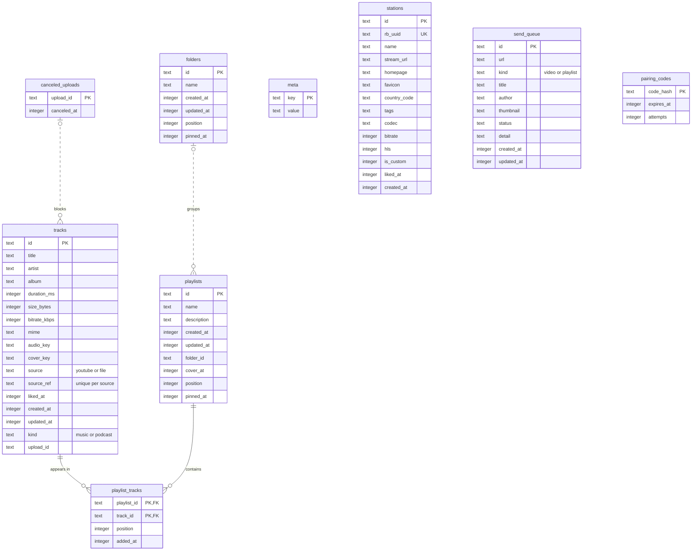

# Worker API reference

The Worker in `apps/api` is the private backend of one person's library when the music lives in
their own Cloudflare account. It serves the JSON API under `/api/*`, streams files from R2 under
`/media/*` and serves the web app for every other path. Metadata is stored in D1 and audio and
covers in a private R2 bucket.

For the shared service (playlists links, Jams, groups) see the [Hub API reference](hub.md).

## Base URL and authentication

The base URL is the address of your own deployment, for example `http://localhost:8787` in local
development. Paths below are relative to it.

There are no user accounts. The single secret is `ACCESS_KEY`, a Worker secret of at least 24
characters. If it is missing or shorter, authentication fails closed with `500 not_configured`.

A request is authenticated by the first of these that applies:

| Credential            | How it is sent                    | Typical client                               |
| --------------------- | --------------------------------- | -------------------------------------------- |
| Access key            | `Authorization: Bearer <key>`     | Ingest CLI                                   |
| Device token (`v1.…`) | `Authorization: Bearer <token>`   | Apps on another origin, such as Android      |
| Device token in URL   | `?t=<token>`, only under `/media` | Media elements, which cannot send headers    |
| Session cookie        | `aske_session` cookie             | Browser on the same origin as the deployment |

- When a `Bearer` header is present, only that header is checked.
- A device token has the form `v1.<issuedAt>.<signature>`, signed with HMAC-SHA-256 using
  `ACCESS_KEY`. It is stateless, lasts up to 400 days, and rotating the key invalidates every token.
- The cookie holds the same token. It is `HttpOnly`, `SameSite=Strict`, `Path=/`, and `Secure` when
  the Worker is served over HTTPS.
- Every path under `/api` and `/media` requires authentication, except `GET /api/health`,
  `GET /api/auth/status`, `POST /api/auth/pair` and `POST /api/auth/logout`. Otherwise the answer is
  `401 unauthorized`.

### Pairing codes

A paired device can create a one-time code to link another device without typing the key. A code has
8 symbols from `23456789ABCDEFGHJKLMNPQRSTUVWXYZ` (case, spaces and dashes are ignored on input),
is valid for 10 minutes and works once. Only one code is active at a time, only its hash is stored,
and it is dropped after 5 failed attempts.

## Conventions

- Bodies are JSON unless stated otherwise. Timestamps are Unix epoch milliseconds.
- Ids are random strings. A path id that does not match `^[A-Za-z0-9_-]{8,40}$` answers
  `404 not_found`.
- `/api` responses carry `Cache-Control: no-store` unless an endpoint sets its own value.
- CORS (`/api/*` and `/media/*`) allows `https://localhost`, `http://localhost`,
  `capacitor://localhost` and the comma-separated origins in `CORS_ORIGINS`. Cross-origin
  credentials are not allowed. Allowed request headers: `Authorization`, `Content-Type`,
  `If-None-Match`, `Range`. Exposed response headers: `ETag`, `Content-Range`, `Content-Length`,
  `Accept-Ranges`.

### Error format

```json
{ "error": "not_found", "message": "Track not found" }
```

| Status | `error`              | When                                                    |
| ------ | -------------------- | ------------------------------------------------------- |
| 400    | `invalid_json`       | The body is not valid JSON                              |
| 400    | `validation_error`   | A body, query or part does not match the rules          |
| 400    | `invalid_form`       | `multipart/form-data` was expected                      |
| 400    | `missing_audio`      | No `audio` part in an upload                            |
| 400    | `missing_cover`      | No `cover` part in a playlist cover upload              |
| 400    | `folder_not_found`   | A playlist is moved to a folder that does not exist     |
| 400    | `playlist_full`      | The playlist would exceed 1000 songs                    |
| 400    | `not_a_permutation`  | A reorder does not contain exactly the same songs       |
| 401    | `unauthorized`       | The request is not authenticated                        |
| 401    | `invalid_key`        | Pairing with a wrong access key                         |
| 401    | `invalid_code`       | Pairing with a wrong or expired code                    |
| 404    | `not_found`          | Unknown resource, or unknown `/api` endpoint            |
| 409    | `duplicate`          | The source is already in the library                    |
| 410    | `upload_canceled`    | The upload was canceled before it was saved             |
| 413    | `too_large`          | The audio file exceeds the size limit                   |
| 415    | `unsupported_audio`  | The audio is not an Ogg or WebM file                    |
| 415    | `unsupported_cover`  | The cover is not a JPEG of 2 MB or less                 |
| 500    | `not_configured`     | `ACCESS_KEY` is missing or too short                    |
| 500    | `internal_error`     | Unexpected error; details are only logged on the server |
| 502    | `radio_unavailable`  | The radio catalog cannot be reached                     |
| 502    | `search_unavailable` | YouTube search cannot be reached                        |
| 507    | `storage_full`       | The upload would go over 95 % of the storage budget     |

### Limits

Defined in `LIMITS` (`packages/shared`).

| Limit                    | Value           |
| ------------------------ | --------------- |
| Title, artist and album  | 300 characters  |
| Playlist and folder name | 120 characters  |
| Playlist description     | 500 characters  |
| Songs per playlist       | 1000            |
| Audio file               | 95 MiB          |
| Cover (song or playlist) | 2 MiB           |
| URL                      | 2048 characters |

The storage budget is `STORAGE_LIMIT_GB` (default 10, with 1 GB = 1,000,000,000 bytes). Used space
is the sum of audio sizes plus an estimate of 80,000 bytes per cover. Uploads stop at 95 % of the
budget with `507 storage_full`.

## Endpoints

| Method | Path                                 | Auth     | Success       |
| ------ | ------------------------------------ | -------- | ------------- |
| GET    | `/api/health`                        | none     | 200           |
| GET    | `/api/auth/status`                   | none     | 200           |
| POST   | `/api/auth/pair`                     | key/code | 200           |
| POST   | `/api/auth/pairing-codes`            | required | 201           |
| POST   | `/api/auth/logout`                   | none     | 200           |
| GET    | `/api/library`                       | required | 200, 304      |
| GET    | `/api/library/storage`               | required | 200           |
| PATCH  | `/api/tracks/:id`                    | required | 200           |
| DELETE | `/api/tracks/:id`                    | required | 204           |
| POST   | `/api/playlists`                     | required | 201           |
| PUT    | `/api/playlists/order`               | required | 200           |
| PATCH  | `/api/playlists/:id`                 | required | 200           |
| DELETE | `/api/playlists/:id`                 | required | 204           |
| PUT    | `/api/playlists/:id/cover`           | required | 200           |
| DELETE | `/api/playlists/:id/cover`           | required | 200           |
| POST   | `/api/playlists/:id/tracks`          | required | 200           |
| PUT    | `/api/playlists/:id/tracks`          | required | 200           |
| DELETE | `/api/playlists/:id/tracks/:trackId` | required | 200           |
| POST   | `/api/folders`                       | required | 201           |
| PUT    | `/api/folders/order`                 | required | 200           |
| PATCH  | `/api/folders/:id`                   | required | 200           |
| DELETE | `/api/folders/:id`                   | required | 204           |
| GET    | `/api/stations`                      | required | 200           |
| POST   | `/api/stations`                      | required | 201           |
| PATCH  | `/api/stations/:id`                  | required | 200           |
| DELETE | `/api/stations/:id`                  | required | 204           |
| GET    | `/api/radio/stations`                | required | 200           |
| GET    | `/api/radio/tags`                    | required | 200           |
| GET    | `/api/radio/countries`               | required | 200           |
| POST   | `/api/radio/click/:uuid`             | required | 202           |
| GET    | `/media/audio/:id`                   | required | 200, 206, 304 |
| GET    | `/media/cover/:id`                   | required | 200, 206, 304 |
| GET    | `/media/playlist-cover/:id`          | required | 200, 206, 304 |
| GET    | `/api/ingest/exists`                 | required | 200           |
| POST   | `/api/ingest/tracks`                 | required | 201           |
| DELETE | `/api/ingest/uploads/:uploadId`      | required | 200           |
| GET    | `/api/youtube/search`                | required | 200           |
| GET    | `/api/send`                          | required | 200           |
| POST   | `/api/send`                          | required | 201           |
| PATCH  | `/api/send/:id`                      | required | 200           |
| DELETE | `/api/send/:id`                      | required | 204           |

Any authenticated endpoint can also answer `401 unauthorized` or `500`. Those are not repeated
below.

## Health

### `GET /api/health`

Returns `{ "ok": true, "version": "<Worker version>" }`.

## Auth

### `GET /api/auth/status`

Returns `{ "paired": boolean }` for the credentials of the request.

### `POST /api/auth/pair`

Exchanges the access key or a pairing code for a device token.

- Body: `{ "key": string }` (1 to 512 characters) or `{ "code": string }` (1 to 64 characters).
- 200: `{ "paired": true, "token": "v1.…" }`, and sets the `aske_session` cookie.
- Errors: 400 `invalid_json` or `validation_error`, 401 `invalid_key` or `invalid_code`.

### `POST /api/auth/pairing-codes`

Creates a pairing code, replacing any previous one. No body.

- 201: `{ "code": string, "expiresAt": number }`.

### `POST /api/auth/logout`

Clears the session cookie and returns `{ "paired": false }`. It does not revoke tokens.

## Library

### `GET /api/library`

The full snapshot: `{ version, tracks, playlists, folders }`.

- `tracks` are ordered newest first. `playlists` and `folders` list pinned items first (most
  recently pinned on top), then those never ordered (playlists by creation date, folders by name),
  then by position.
- The response has `ETag: "v<version>"` and `Cache-Control: no-cache`. Send it back in
  `If-None-Match` to get `304` with no body when nothing changed.
- Changes to tracks, playlists and folders bump the version. Saved stations and the send queue are
  not part of the library.

| Object     | Fields                                                                                                                                        |
| ---------- | --------------------------------------------------------------------------------------------------------------------------------------------- |
| `Track`    | `id`, `title`, `artist`, `album`, `durationMs`, `sizeBytes`, `bitrateKbps`, `hasCover`, `kind`, `source`, `sourceRef`, `likedAt`, `createdAt` |
| `Playlist` | `id`, `name`, `description`, `trackIds` (ordered), `createdAt`, `updatedAt`, `folderId`, `coverAt`, `position`, `pinnedAt`                    |
| `Folder`   | `id`, `name`, `createdAt`, `updatedAt`, `position`, `pinnedAt`                                                                                |

### `GET /api/library/storage`

Returns `{ trackCount, usedBytes, limitBytes, uploadLimitBytes }`.

## Tracks

### `PATCH /api/tracks/:id`

- Body, at least one field: `title` (1 to 300), `artist` (up to 300), `album` (up to 300), `liked`
  (boolean), `kind` (`music` or `podcast`).
- Liking a song that is already liked keeps its original `likedAt`.
- 200: the `Track`. Errors: 400, 404.

### `DELETE /api/tracks/:id`

Deletes the song, removes it from every playlist and deletes its audio and cover.

- 204. Errors: 404.

## Playlists

`trackIds` arrays accept up to 1000 ids; repeated ids are removed.

### `POST /api/playlists`

- Body: `name` (required, 1 to 120), `description` (up to 500, default empty), `trackIds` (default
  empty). Ids that are not in the library are skipped.
- 201: the `Playlist`, placed at the end of the top level. Errors: 400.

### `PUT /api/playlists/order`

Reorders the playlists of one container.

- Body: `folderId` (id, or `null` for the top level) and `ids` (up to 1000), both required.
- Listed ids go first and the rest keep their order. Unknown ids and ids from other containers are
  ignored.
- 200: `{ "playlists": Playlist[] }` with every playlist. Errors: 400.

### `PATCH /api/playlists/:id`

- Body, at least one field: `name` (1 to 120), `description` (up to 500), `folderId` (id or
  `null`), `pinned` (boolean). Changing `folderId` moves the playlist to the end of the target.
- 200: the `Playlist`. Errors: 400 (including `folder_not_found`), 404.

### `DELETE /api/playlists/:id`

Deletes the playlist and its custom cover. Songs stay in the library.

- 204. Errors: 404.

### `PUT /api/playlists/:id/cover`

- Body: `multipart/form-data` with one part, `cover`: a non-empty JPEG of 2 MiB or less. The client
  resizes it before uploading.
- 200: the `Playlist` with its new `coverAt`.
- Errors: 400 `invalid_form` or `missing_cover`, 404, 415 `unsupported_cover`, 507
  `storage_full` (replacing an existing cover adds nothing to the estimate).

### `DELETE /api/playlists/:id/cover`

Removes the custom cover.

- 200: the `Playlist`. Errors: 404.

### `POST /api/playlists/:id/tracks`

Appends songs. Songs already in the playlist keep their position; unknown ids are skipped.

- Body: `{ "trackIds": string[] }`.
- 200: the `Playlist`. Errors: 400 (including `playlist_full`), 404.

### `PUT /api/playlists/:id/tracks`

Replaces the order of the songs.

- Body: `{ "trackIds": string[] }`, a permutation of the current songs.
- 200: the `Playlist`. Errors: 400 (including `not_a_permutation`), 404.

### `DELETE /api/playlists/:id/tracks/:trackId`

Removes one song from the playlist.

- 200: the `Playlist`. Errors: 404.

## Folders

Folders have a single level and only hold playlists.

### `POST /api/folders`

- Body: `{ "name": string }` (1 to 120).
- 201: the `Folder`. Errors: 400.

### `PUT /api/folders/order`

- Body: `{ "ids": string[] }` (up to 1000). Listed ids go first and the rest keep their order;
  unknown ids are ignored.
- 200: `Folder[]`. Errors: 400.

### `PATCH /api/folders/:id`

- Body, at least one field: `name` (1 to 120), `pinned` (boolean).
- 200: the `Folder`. Errors: 400, 404.

### `DELETE /api/folders/:id`

Deletes the folder. Its playlists go back to the top level.

- 204. Errors: 404.

## Saved stations

A `Station` has `id`, `rbUuid`, `name`, `streamUrl`, `homepage`, `favicon`, `countryCode`, `tags`,
`codec`, `bitrate`, `hls`, `isCustom`, `likedAt` and `createdAt`.

### `GET /api/stations`

Returns `Station[]`: liked stations first (latest like on top), then the rest by name.

### `POST /api/stations`

Saves a station. A station with a known `rbUuid` is updated instead of duplicated.

| Field                 | Rules                                                       |
| --------------------- | ----------------------------------------------------------- |
| `name`                | Required, 1 to 120                                          |
| `streamUrl`           | Required URL starting with `http://` or `https://`          |
| `rbUuid`              | Radio Browser UUID or `null` (default `null`: custom entry) |
| `homepage`, `favicon` | Up to 2048, default empty                                   |
| `countryCode`         | Up to 8, default empty                                      |
| `tags`                | Up to 20 strings of up to 60, default empty                 |
| `codec`               | Up to 30, default empty                                     |
| `bitrate`             | Integer 0 to 10000, default 0                               |
| `hls`                 | Boolean, default `false`                                    |
| `liked`               | Boolean, default `true`                                     |

- 201: the `Station`. Errors: 400.

### `PATCH /api/stations/:id`

- Body, at least one field: `liked` (boolean), `name` (1 to 120).
- 200: the `Station`. Errors: 400, 404.

### `DELETE /api/stations/:id`

- 204. Errors: 404.

## Radio catalog

A proxy for the Radio Browser catalog.

### `GET /api/radio/stations`

| Query     | Rules                                              |
| --------- | -------------------------------------------------- |
| `q`       | Name search, up to 100                             |
| `country` | Two-letter country code                            |
| `tag`     | Up to 60                                           |
| `order`   | `votes` (default), `clickcount`, `name` or `trend` |
| `offset`  | 0 to 10000, default 0                              |
| `limit`   | 1 to 60, default 30                                |

- 200: an array of `{ rbUuid, name, streamUrl, homepage, favicon, countryCode, tags, codec,
bitrate, hls, votes, clickCount }`, cacheable privately for 5 minutes.
- Errors: 400, 502 `radio_unavailable`.

### `GET /api/radio/tags`

Up to 40 tags as `{ name, stationCount }`, cacheable privately for 1 day.

- Errors: 502 `radio_unavailable`.

### `GET /api/radio/countries`

Countries as `{ code, name, stationCount }`, cacheable privately for 1 day.

- Errors: 502 `radio_unavailable`.

### `POST /api/radio/click/:uuid`

Reports in the background that a catalog station was played.

- 202 with no body. Errors: 400 if `uuid` is not UUID-shaped.

## Media streaming

Files are read straight from R2. All three endpoints behave the same way:

- `Range` requests answer `206` with `Content-Range` and `Content-Length`. A range that cannot be
  satisfied answers `416` with `Content-Range: bytes */<size>`.
- Responses carry `ETag`, `Accept-Ranges: bytes` and
  `Cache-Control: private, max-age=31536000, immutable`. A matching `If-None-Match` answers `304`.
- A missing file answers `404 not_found`.
- The token may be passed as `?t=<token>`.

### `GET /media/audio/:id`

Audio of a song, as `audio/ogg; codecs=opus` or `audio/webm; codecs=opus`.

### `GET /media/cover/:id`

JPEG cover of a song.

### `GET /media/playlist-cover/:id`

Custom JPEG cover of a playlist.

## Ingest

Used by the ingest CLI and by the apps to upload songs.

### `GET /api/ingest/exists`

- Query: `source` (`youtube` or `file`) and `ref` (1 to 200).
- 200: `{ "exists": boolean, "id": string | null }`. Errors: 400.

### `POST /api/ingest/tracks`

`multipart/form-data` with these parts:

| Part    | Content                                                                             |
| ------- | ----------------------------------------------------------------------------------- |
| `meta`  | JSON string, see below                                                              |
| `audio` | Opus audio in an Ogg or WebM container, up to 95 MiB; the file signature is checked |
| `cover` | Optional JPEG, up to 2 MiB                                                          |

| `meta` field  | Rules                                              |
| ------------- | -------------------------------------------------- |
| `title`       | Required, 1 to 300                                 |
| `artist`      | Up to 300, default empty                           |
| `album`       | Up to 300, default empty                           |
| `durationMs`  | Required integer, above 0 and at most 24 hours     |
| `bitrateKbps` | Integer 1 to 2000 or `null` (default)              |
| `source`      | Required: `youtube` or `file`                      |
| `sourceRef`   | 1 to 200 or `null` (default)                       |
| `kind`        | `music` (default) or `podcast`                     |
| `uploadId`    | Optional, `^[A-Za-z0-9_-]{1,100}$`, used to cancel |

- 201: the `Track`.
- Errors: 400 `invalid_form`, `validation_error` or `missing_audio`; 409 `duplicate`; 410
  `upload_canceled`; 413 `too_large`; 415 `unsupported_audio` or `unsupported_cover`; 507
  `storage_full`.

### `DELETE /api/ingest/uploads/:uploadId`

Cancels an upload: deletes the song it already created and rejects it if it arrives later (the
cancellation is remembered for 30 days).

- Query (optional, only together): `ref` (YouTube id, up to 64) and `since` (epoch milliseconds).
  They also delete a YouTube song with no upload id, saved by an older Worker since that moment.
- 200: `{ "deletedIds": string[] }`. Errors: 400.

## YouTube search and "Send to phone"

The Worker never downloads from YouTube. It searches, and keeps a queue that the phone downloads.

### `GET /api/youtube/search`

| Query          | Rules                                      |
| -------------- | ------------------------------------------ |
| `q`            | Required, 1 to 200                         |
| `kind`         | `songs` (default), `videos` or `playlists` |
| `lang`         | `es` (default), `en` or `eu`               |
| `continuation` | Token from a previous page, up to 4096     |

- 200: `{ results, continuation }`. A result has `kind` (`video` or `playlist`), `id`, `title`,
  `author`, `thumbnail`, `url` and, when known, `album`, `duration` (seconds) and `count`.
  `continuation` is `null` when there are no more pages.
- Errors: 400, 502 `search_unavailable`.

### `GET /api/send`

Returns up to 200 queue items, newest first: pending and taken ones, plus others updated in the last
7 days. An item has `id`, `url`, `kind` (`video` or `playlist`), `title`, `author`, `thumbnail`,
`status`, `detail`, `createdAt` and `updatedAt`.

### `POST /api/send`

- Body: `url` (required YouTube or YouTube Music link to a song or playlist), `title` and `author`
  (up to 300, default empty), `thumbnail` (empty or `https://`, up to 2048).
- 201: the item, with status `pending`. A link containing a video id is stored as `video`.
- Errors: 400.

### `PATCH /api/send/:id`

- Body: `status` (required: `pending`, `taken`, `done` or `error`) and `detail` (up to 500, default
  empty).
- 200: the item. Errors: 400, 404.

### `DELETE /api/send/:id`

- 204. Errors: 404.

## Data model (D1)

Taken from `apps/api/migrations`. Only `playlist_tracks` declares foreign keys (with cascade
delete); dashed lines are relations kept by the application. `meta` holds `library_version`.


