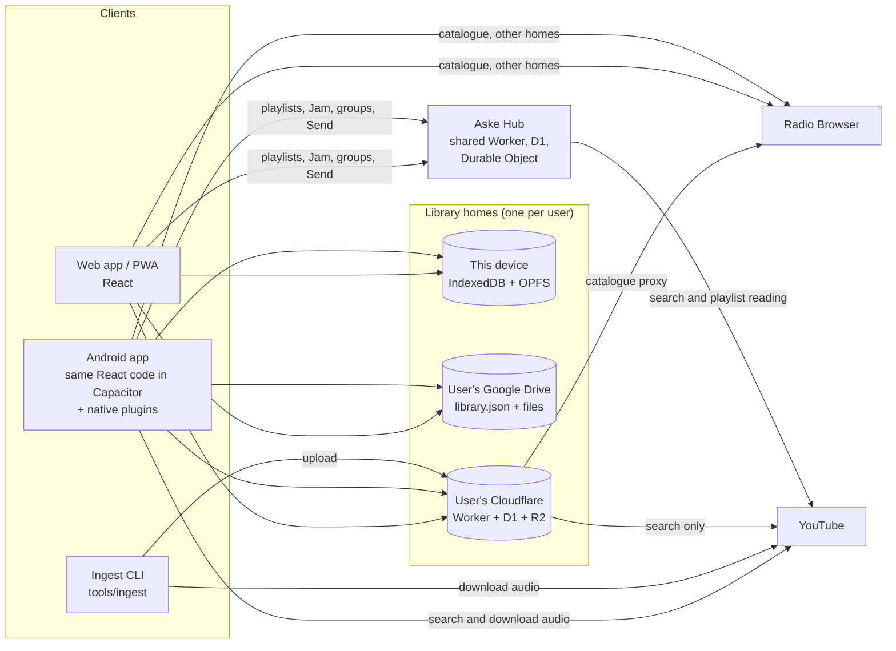
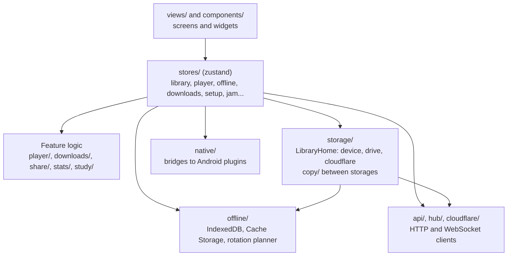
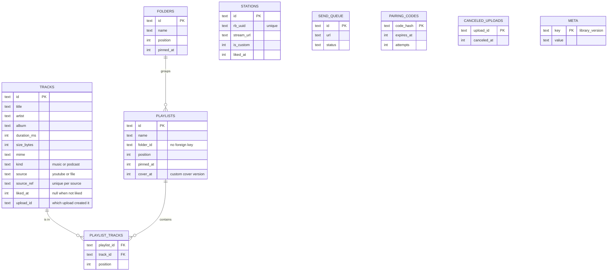
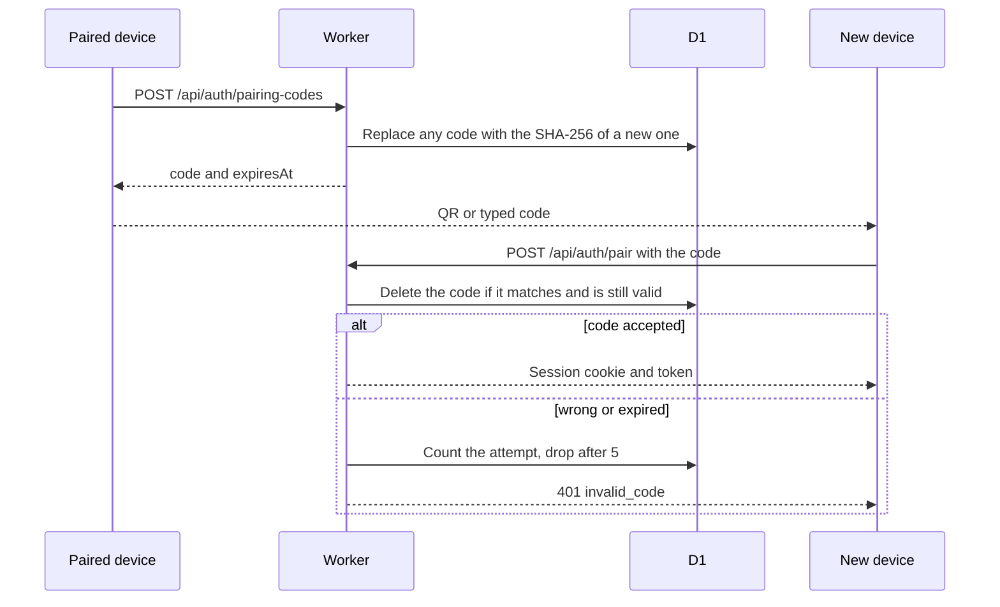
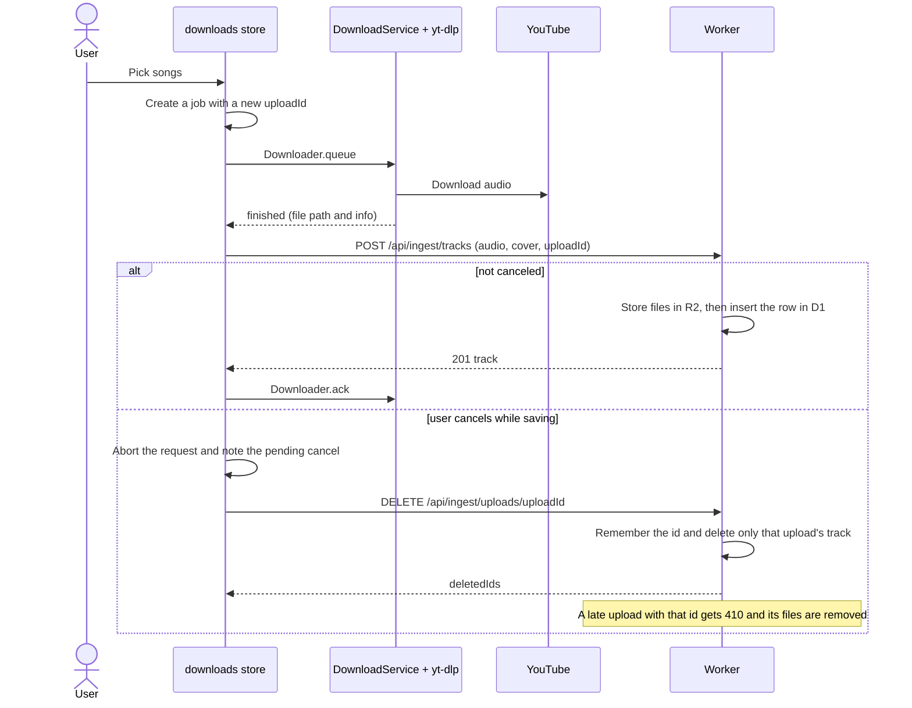
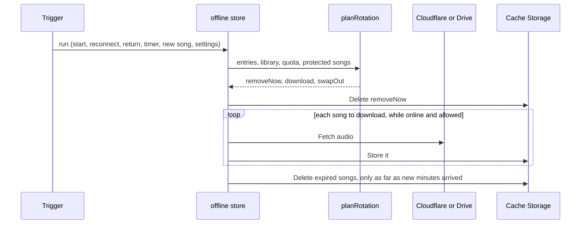

# Architecture

Aske Stream is one React app that runs in a browser (PWA) and inside an Android shell. Each user
picks one place for their library: this device, their own Google Drive or their own Cloudflare
account. A small shared service, the Aske Hub, connects people (shared playlists, Jams, friend
groups) and never stores music.

Related documents: [decision records](adr/README.md), [Android app](android.md),
[Google Drive](google-drive.md), [offline cache](offline-cache.md), [Aske Hub](hub.md),
[privacy policy](PRIVACY.md).

## System context



- Within the app, audio is downloaded from YouTube **only by the phone**. The Worker and the Hub
  query YouTube for search results (the Hub also reads playlists), never audio. The ingest CLI is
  a separate tool that downloads on the owner's computer.
- Thumbnails of songs that are not in the library are requested by the device directly from
  YouTube's image servers (see [PRIVACY.md](PRIVACY.md)).
- Radio streams are played directly from each station. The catalogue goes through the Worker when
  the home is Cloudflare, and straight to Radio Browser otherwise.

## Monorepo modules

| Path              | What it is                                                                          |
| ----------------- | ----------------------------------------------------------------------------------- |
| `apps/web`        | The app: React 19, Vite, zustand, wouter, IndexedDB (`idb`)                         |
| `apps/api`        | The user's own Cloudflare Worker: Hono + zod, D1, R2                                |
| `apps/hub`        | The Aske Hub: a separate Worker with its own D1 and the `JamRoom` Durable Object    |
| `apps/mobile`     | Capacitor 8 Android project and its Java plugins                                    |
| `packages/shared` | Types, limits (`LIMITS`, `HUB_LIMITS`), pairing and YouTube InnerTube parsing       |
| `tools/ingest`    | CLI that adds YouTube links and local files to a Cloudflare library                 |
| `scripts`         | Development, smoke test, documentation checks and the Cloudflare bundle for the APK |

## Layers of the web app



- **One interface, three homes.** Stores talk to `LibraryHome`
  (`apps/web/src/storage/types.ts`): `cloudflareHome` and `deviceHome` live in
  `storage/homes.ts`, `driveHome` in `storage/drive/home.ts`
  ([ADR 0006](adr/0006-storage-homes.md)).
- **Optimistic changes.** Library edits show at once and roll back if the home rejects them.
- **Player.** Playback uses an `HTMLAudioElement` with the Media Session API (a native media
  session on Android). The source is chosen per song: file on the device, offline cache,
  Cloudflare stream, then Google Drive (`storage/media.ts`). Shuffle keeps a seeded order per
  round ([ADR 0011](adr/0011-seeded-shuffle.md)).
- **Radio.** Plain `<audio>` for MP3/AAC streams, `hls.js` (loaded on demand) where the browser
  has no native HLS.
- **Native bridges.** `vite build --mode fakenative` swaps the files in `src/native/` for fakes, so
  browser tests can drive the Android flows.
- **Languages.** English, Spanish and Basque (`i18n/`, `help/articles/`), with tests that keep
  them complete.

## Data model

### Cloudflare home: D1

Built by the migrations in `apps/api/migrations`. Request and response shapes are in the
[Worker API reference](api/worker.md).



- Likes are a column (`liked_at`): there is one owner, and the timestamp orders "Liked songs".
- `library_version` is bumped together with library writes and served as the ETag of
  `GET /api/library`, so the app revalidates its cached copy with a `304`
  ([ADR 0002](adr/0002-d1-for-metadata.md)).
- Adding songs to a playlist and reordering are set-based (`json_each()`), which keeps requests
  within the free plan's query budget.

### Cloudflare home: R2

```
tracks/<trackId>/audio.opus    Opus in Ogg or WebM (the stored Content-Type says which)
tracks/<trackId>/cover.jpg     square JPEG (optional)
playlists/<playlistId>/cover.jpg   custom playlist cover (optional)
```

The bucket is private. The Worker streams objects under `/media/*` with `Range` support.

### Drive home and device

| Where              | What                                                                              |
| ------------------ | --------------------------------------------------------------------------------- |
| Google Drive       | `Aske Stream/library.json`, `audio/`, `covers/` ([details](google-drive.md))      |
| IndexedDB (`aske`) | Library (device home or cached copy), offline entries, plays, study, phone extras |
| OPFS               | Audio and covers stored on the device (`storage/deviceFiles.ts`)                  |
| Cache Storage      | Offline copies of cloud songs (`aske-audio-v1`)                                   |

## Security

### Pairing a device with a Cloudflare home

There is one owner and no accounts ([ADR 0003](adr/0003-single-owner-auth.md)). The first device
uses the `ACCESS_KEY`. Further devices use a one-time code.



- The code has 8 characters, lasts 10 minutes, works once and only one is active at a time.
- The session is `v1.<issuedAt>.<HMAC-SHA-256>`, signed with `ACCESS_KEY` and valid for 400 days.
  Changing the key signs every device out.
- Same-origin browsers get it as an `HttpOnly`, `SameSite=Strict` cookie (`Secure` over HTTPS).
  The Android app sends it as a Bearer token. `<audio>` cannot send headers, so `/media/*` URLs
  also accept it as `?t=`.
- The CLI sends the access key itself as a Bearer token.
- **Fail closed:** a missing key, or one shorter than 24 characters, makes protected routes answer
  `500 not_configured`.

### Other measures

- Worker inputs are validated (zod and file signature checks), SQL uses bound parameters, errors
  are JSON `{ error, message }` and `/api/*` gets secure headers and `no-store` by default.
- CORS on the Worker only allows the Android app origins plus those in `CORS_ORIGINS`.
- Google Drive access is limited to `drive.file`. The web token is kept in `sessionStorage`
  ([ADR 0007](adr/0007-google-drive-home.md)).
- The Cloudflare API token typed into the setup assistant is never stored.
- The Hub has no accounts. It keeps hashes of device keys and applies per-IP limits using salted
  hashes ([Aske Hub](hub.md)).
- Usage statistics are not collected. Listening history is opt-in
  ([ADR 0013](adr/0013-opt-in-listening-stats.md)).

## Downloading on the phone

The phone downloads the audio with yt-dlp and saves it, without re-encoding, into the library's
home ([ADR 0008](adr/0008-youtube-download-on-the-phone.md)). The diagram shows a Cloudflare home.



- Cancelling targets only what that upload created. Cancels that cannot be delivered are retried
  later. The exception for old Workers, and the Drive equivalent, are in
  [ADR 0012](adr/0012-upload-ids-safe-cancel.md).
- A device home writes to OPFS instead. With a Cloudflare home, audio over 95 MB (or over 30 MB
  after repeated server or timeout failures) stays on that phone only.

## Offline

- The service worker precaches the app shell and caches covers. It does not handle audio
  ([ADR 0005](adr/0005-offline-audio-in-cache-storage.md)).
- The library is cached in IndexedDB. A connectivity probe with a 4 s timeout switches the app to
  offline mode, and retries with growing delays.
- Cloud songs (not podcasts, not files already on the device) take part in the rotating offline
  cache. The policy is the pure function `planRotation()`; see [offline-cache.md](offline-cache.md).



With the app hidden, the timer and new-song runs need music playing and either charging, or Wi-Fi
with battery saver off. Automatic downloads on mobile data are off by default.

## Android

The Android app wraps the same web build and plays through the WebView's `<audio>`
([ADR 0009](adr/0009-capacitor-webview-native-plugins.md)). A media session plugin
(`@capgo/capacitor-media-session`) provides the notification and keeps playback alive.

| Plugin          | Job                                                        |
| --------------- | ---------------------------------------------------------- |
| `AskeNative`    | Wake and Wi-Fi locks, in-app updates, storage and battery  |
| `Downloader`    | yt-dlp queue in a foreground service                       |
| `GoogleDrive`   | Drive tokens from Google Play services                     |
| `CloudflareApi` | Calls to the Cloudflare API for the guided setup (no CORS) |
| `QrScanner`     | Reads pairing and Send codes                               |
| `StudyLock`     | Screen pinning and the end-of-session chime                |
| `ShareTarget`   | Receives "Share -> Aske Stream"                            |

The APK also carries a `cf-bundle` (Worker, web files and D1 migrations) so the app can create or
update the user's Cloudflare server. Permissions, updates and releases are described in
[android.md](android.md).

## Aske Hub

A second Worker, run once for everybody ([ADR 0010](adr/0010-aske-hub-and-jam.md)). It stores
song references (YouTube ids and titles), parcels for "Send to phone", friend groups and, only for
people who switch it on, monthly listening figures. Each Jam is a Durable Object that talks over
WebSocket; only the host's phone plays and performs skips. An hourly job deletes expired data.
Endpoints: [Hub API reference](api/hub.md).

## Startup

The opening screen is drawn by inline HTML and CSS in `apps/web/index.html`, so it moves before
any JavaScript loads.

1. The logo animates in; if loading takes longer than the 1.4 s intro, its bars become an
   equalizer.
2. The app is ready when the setup is loaded and the connection check has answered, or after 5 s
   (`lib/boot.ts`).
3. `lib/bootSplash.ts` settles the bars, lets the app mount underneath, fades the screen out and
   removes it.

`apps/web/test/browser/v11_097.py` records and checks this sequence.

## Limits

| Limit                         | Value                                                     |
| ----------------------------- | --------------------------------------------------------- |
| Cloudflare storage budget     | 10 GB (`STORAGE_LIMIT_GB`)                                |
| Upload cut-off                | 95 % of the budget: uploads answer `507 storage_full`     |
| Songs per playlist            | 1000 (`LIMITS.playlistMaxTracks`)                         |
| Audio file sent to the Worker | 95 MB (`LIMITS.audioMaxBytes`)                            |
| Cover                         | JPEG up to 2 MB                                           |
| Songs in a library            | No fixed limit                                            |
| Jam                           | 30 connections, 200 queued songs, 12 hours (`HUB_LIMITS`) |
