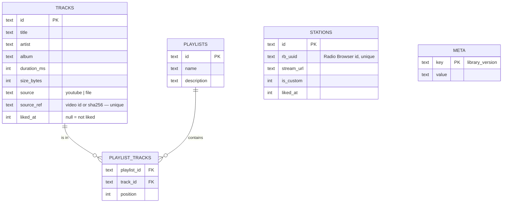
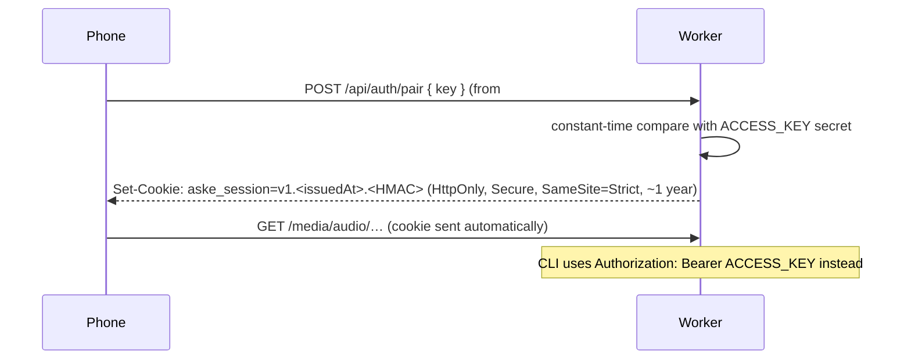
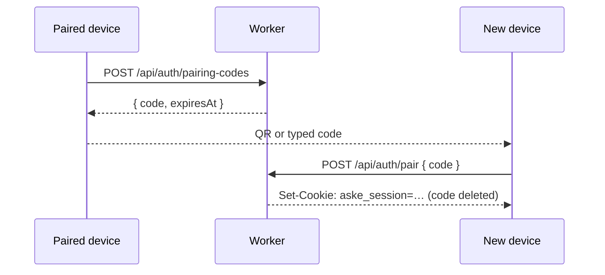

# Architecture

## Overview

One Cloudflare Worker serves everything from a single origin:

- `/*` — the PWA's static files (served by Cloudflare's asset layer without invoking the Worker);
- `/api/*` — the JSON API (Hono);
- `/media/*` — audio and covers streamed from a **private** R2 bucket.

Same origin means the session cookie can be `SameSite=Strict` + `HttpOnly`, there is no CORS
configuration, and `<audio src="/media/audio/…">` carries the cookie automatically.

## Data model (D1)



- **Likes are a column** (`liked_at`), not a table: one user, and the timestamp orders “Liked songs”.
- **`library_version`** is bumped in the same transaction as every write. `GET /api/library`
  returns it as the ETag, so the app revalidates its cached library with a cheap `304`.
- Playlist changes are **set-based** (`json_each()`): a single SQL statement adds or reorders
  any number of songs. This matters because the free plan allows 50 D1 queries per request.

## Storage layout (R2)

```
tracks/<trackId>/audio.opus   Ogg Opus, Content-Type audio/ogg; codecs=opus
tracks/<trackId>/cover.jpg    512×512 JPEG (optional)
```

Keys derive from the id, so streaming needs no database lookup. Objects are immutable and
served with `Cache-Control: private, max-age=31536000, immutable`.

## API

| Method & path                                                                | Purpose                                               |
| ---------------------------------------------------------------------------- | ----------------------------------------------------- |
| `GET /api/health`                                                            | Liveness and Worker `version` (public)                |
| `GET /api/auth/status` · `POST /api/auth/pair` · `POST /api/auth/logout`     | Device pairing (`pair` takes `{ key }` or `{ code }`) |
| `POST /api/auth/pairing-codes`                                               | New one-use pairing code (paired devices only)        |
| `GET /api/library`                                                           | Full snapshot (tracks + playlists), ETag/304          |
| `PATCH /api/tracks/:id` · `DELETE /api/tracks/:id`                           | Edit metadata, like/unlike, delete (also from R2)     |
| `POST /api/playlists` · `PATCH/DELETE /api/playlists/:id`                    | Playlist CRUD                                         |
| `POST/PUT /api/playlists/:id/tracks` · `DELETE …/tracks/:trackId`            | Add, reorder, remove songs                            |
| `GET/POST /api/stations` · `PATCH/DELETE /api/stations/:id`                  | Saved and liked radio stations                        |
| `GET /api/radio/stations · tags · countries` · `POST /api/radio/click/:uuid` | Radio Browser proxy                                   |
| `GET /api/ingest/exists` · `POST /api/ingest/tracks`                         | Used by the CLI (multipart upload)                    |
| `GET /media/audio/:id` · `GET /media/cover/:id`                              | Streaming with `Range`, `ETag`, `304`, `416`          |

All inputs are validated with Zod; errors are JSON `{ error, message }`.

## Authentication — single owner, no accounts



- A paired device can also link another one without the key: `POST /api/auth/pairing-codes`
  returns an 8-character code (10 minutes, one use, only its SHA-256 is stored in D1). The code
  travels in a QR as `https://<worker>/#code=…` or is typed on a computer; `POST /api/auth/pair`
  `{ code }` consumes it and answers like the key flow. Five wrong tries invalidate it.



- Stateless: the cookie is an HMAC of its issue time signed with the key. Rotating
  `ACCESS_KEY` invalidates every device at once.
- **Fail closed**: if the secret is missing or shorter than 24 characters, every protected
  route answers `500 not_configured` instead of being open.
- The key never touches git: it is a Worker secret, a git-ignored `.env`, and a URL fragment
  (`#key=`), which browsers never send to servers.

See [ADR 0003](adr/0003-single-owner-auth.md) for the alternatives considered.

## Client

```
apps/web/src
├─ api/          typed fetch client
├─ stores/       Zustand stores: session, library, player, offline, radio, ui
├─ player/       pure queue logic (shuffle, next/previous)
├─ offline/      IndexedDB, Cache Storage, rotation planner (pure)
├─ components/   track list, menus, sheets, mini player, full-screen player
├─ views/        library, playlists, playlist, radio, offline, settings, pairing
└─ i18n/         en (source of truth), es, eu — completeness checked by tests
```

- **Player**: one long-lived `HTMLAudioElement` (no Web Audio graph — that is what keeps audio
  alive in the background on mobile). The Media Session API provides lock-screen metadata,
  artwork and controls, including seeking. Online songs stream from `/media/audio/:id`;
  downloaded songs play from a `blob:` URL built from Cache Storage.
- **Library sync**: cached in IndexedDB for instant, offline start; revalidated with the ETag.
  Likes are optimistic and roll back on failure.
- **Service worker** (Workbox): precaches the app shell; covers are cache-first. Audio is
  deliberately not handled by the service worker (see [offline-cache.md](offline-cache.md)).
- **Radio**: plain `<audio>` for Icecast/MP3/AAC streams, `hls.js` (lazy-loaded light build)
  for HLS where the browser lacks native support. The catalog goes through the Worker so it
  can pick a healthy Radio Browser mirror, send a proper User-Agent and cache results.
