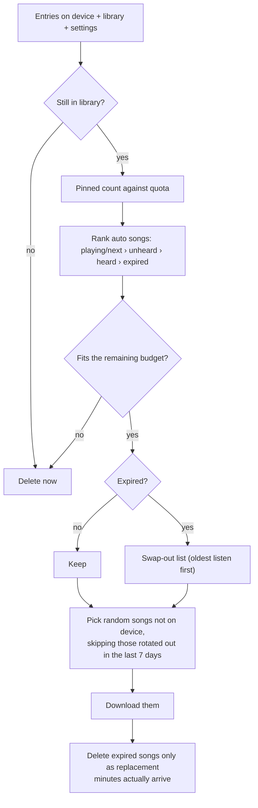

# Smart offline cache

Goal: always have a fresh, bounded selection of your library on the phone, without managing it.

## Settings (Offline tab)

| Setting                  | Default | Meaning                                                                            |
| ------------------------ | ------- | ---------------------------------------------------------------------------------- |
| Offline music            | 2 h     | Budget in **minutes of music** (not MB)                                            |
| Rotate heard songs after | 24 h    | Time after the first listen before a song may be replaced                          |
| Fill automatically       | on      | Pick random songs until the budget is full                                         |
| Download on mobile data  | off     | When off, automatic downloads wait for Wi-Fi (Android exposes the connection type) |

## Two kinds of downloads

- **Pinned** — chosen by you (a song's ⋮ menu, or the download button of a playlist / Liked songs).
  Never rotated, and **they count towards the budget**. If pinned songs alone exceed it, nothing
  is added automatically (the UI says so).
- **Auto** — random picks that fill the rest of the budget and rotate.

## Rotation policy

A song counts as **heard** when it played past **80 %** of its length. An auto song **expires**
when `now − firstHeardAt ≥ rotateAfter`.

Each sync runs the pure function `planRotation()` (`apps/web/src/offline/planner.ts`):

Guarantees, each covered by a unit test:

1. **Never more than the quota** (except the temporary overlap while swapping).
2. **Swap, never drop**: expired songs are deleted only after replacements are downloaded.
   With no connection — or if the whole library already fits — they stay.
3. The song **playing now and the next one** are never removed.
4. Lowering the quota shrinks the cache immediately, keeping unheard songs first.
5. Songs rotated out are not picked again for 7 days, unless the library is too small.

## When does it run?

On app start, when the connection comes back, when you return to the app (at most once a minute),
every 30 minutes while open, after a song starts, and when you change a setting or press
**Sync now**. Downloads are sequential and stop as soon as the connection drops. With the app in
the background (music playing), the periodic run only happens while the phone is charging, or on
Wi-Fi with battery saver off; without reliable data it does not run.

In the web/PWA build (not the Android app) the battery status is not available, so with the tab
hidden and music playing the rotation does not run. This is intentional and conservative: it
avoids draining the battery when we cannot tell whether it is safe.

> A PWA cannot download while closed: browsers give web apps no reliable background
> execution. A native Android client (Kotlin + WorkManager) could do it on top of the same API —
> see the roadmap.

## Storage details

- Audio files: **Cache Storage** (`aske-audio-v1`), whole files keyed by `/media/audio/:id`.
  Playback uses a `blob:` URL, so seeking works offline without faking `206` responses in the
  service worker.
- Metadata: **IndexedDB** (`offline`, `evicted`, cached library).
- On start, entries whose file the browser evicted are dropped (self-healing).
- The app requests **persistent storage** on the first download so the browser does not evict it
  under pressure; Settings shows whether it was granted.
