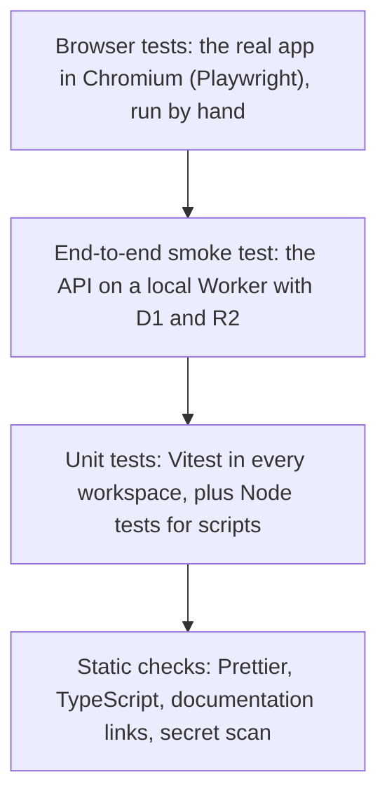
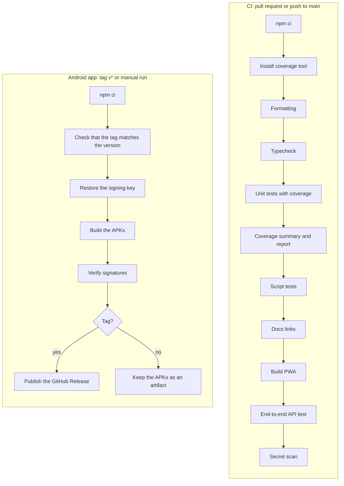

# Testing

Most behaviour is covered by fast unit tests on pure logic. A smaller set of tests exercises the
real Worker and the real app in a browser. Set up the project first with the
[development guide](development.md).



## Everything at once

```bash
npm run check       # formatting, types, tests, script tests, docs links, build
npm run test:e2e    # needs a freshly built apps/web/dist
```

## Unit tests

```bash
npm run test                                              # every workspace
npm run test -w @aske/web                                 # one workspace
npx vitest run test/planner.test.ts --root apps/web       # one file
```

Do not use watch mode (`vitest -w`): it leaves processes hanging.

| Workspace         | Examples of what is tested                                                                                                                                                                                                                       |
| ----------------- | ------------------------------------------------------------------------------------------------------------------------------------------------------------------------------------------------------------------------------------------------ |
| `apps/web`        | Offline rotation (`planner.test.ts`), copying between storages (`copyPlan.test.ts`), merging the Drive library (`driveDoc.test.ts`), canceling uploads (`uploadCancels.test.ts`), the in-app Cloudflare setup against a fake API (`cloudflare/`) |
| `apps/api`        | Upload ids and safe cancellation (`uploads.test.ts`), pairing codes (`pairing.test.ts`), YouTube search                                                                                                                                          |
| `apps/hub`        | Jam rooms and their protocol (`jamRoom.test.ts`, `jamProtocol.test.ts`), groups on D1 emulated with `node:sqlite` (`d1GroupRepo.test.ts`), rate limits                                                                                           |
| `packages/shared` | The YouTube parser against saved responses (`youtube.test.ts`), playlist order, version comparison                                                                                                                                               |
| `tools/ingest`    | Cleaning titles and artists (`metadata.test.ts`)                                                                                                                                                                                                 |

Repository scripts in `scripts/lib/` use the Node test runner:

```bash
npm run test:scripts
```

### Translations and help centre

The interface exists in English, Spanish and Basque, and two tests keep it that way:

- `apps/web/test/i18n.test.ts`: every language defines the same keys as English, keeps the same
  `{placeholders}` and has no empty text.
- `apps/web/test/help.test.ts`: every help article is written in the three languages, links between
  articles point to articles that exist, and web links use `https`.

## End-to-end smoke test

```bash
npm run build
npm run test:e2e
```

[`scripts/smoke.mjs`](../scripts/smoke.mjs) starts its own Worker with `wrangler dev` on a random
port, with temporary D1 and R2 storage, and calls the API as a client would: pairing,
authentication, uploads, Range streaming, playlists, folders, stations, upload cancellation, the
storage limit and more. It does not touch your local data. To run it against a Worker that is
already up:

```bash
node scripts/smoke.mjs --url http://localhost:8787 --key <ACCESS_KEY>
```

Set `SMOKE_DEBUG=1` to see the Worker's error output. If you keep a `wrangler dev` running, restart
it after each web build.

## Browser tests

Python and Playwright scripts drive the app in Chromium against `wrangler dev`, including the
Android screens through the `fakenative` build. They are not part of CI. Which build each one needs
is in [apps/web/test/browser](../apps/web/test/browser/README.md).

Some of them play `apps/web/test/browser/media/song.webm`, which is not in git (media files are
ignored). Any Opus file in WebM works, for example:

```bash
ffmpeg -f lavfi -i "sine=frequency=330:duration=60" -c:a libopus -b:a 32k apps/web/test/browser/media/song.webm
```

## Documentation checks

```bash
npm run docs:check
node scripts/check-docs.mjs --external
```

[`scripts/check-docs.mjs`](../scripts/check-docs.mjs) fails when a Markdown file links to a missing
file, image or `#anchor`, or cites an npm script that does not exist. Release notes and
`docs/plan/` are skipped. `--external` also requests the web links and only warns; CI does not use
it.

## Coverage

CI runs the unit tests with V8 coverage. The coverage tool is installed in that job only
(`--no-save`), so `package-lock.json` does not change. Each run shows a table per workspace in the
job summary and keeps the HTML report as the `coverage` artifact. No external service is involved.

## Secret scan

CI runs [gitleaks](https://github.com/gitleaks/gitleaks) over the full git history. The rules are
the default ones; [`.gitleaks.toml`](../.gitleaks.toml) only allows the well-known development and
test keys.

## Continuous integration

[`ci.yml`](../.github/workflows/ci.yml) runs on pull requests and on pushes to `main`.
[`android.yml`](../.github/workflows/android.yml) runs on version tags and by hand.


