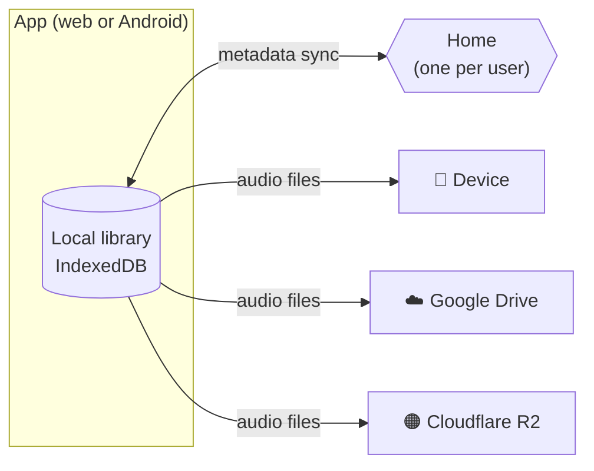

# Aske Stream v2 — architecture

v2 turns aske-stream from "a cloud you deploy" into **an app non-technical friends can install**,
while keeping every v1 feature. This document is the reference for all v2 work.

## Goals (agreed with the owner)

- Everything v1 does keeps working (library, likes, playlists, radio, smart offline cache, web app, CLI).
- **Android app (APK, no Play Store)** with an in-app **YouTube search & download** (songs and playlists).
- **Choose where music is stored**: this device, Google Drive or Cloudflare — **per song and per playlist**.
- **Downloads from the laptop**: technical users keep the CLI; everyone else uses
  **"Send to phone"** — search on the desktop web app, the phone downloads it.
- Downloader and app **update from inside the app** (no reinstall).
- **In-person Jams**: one phone plays, friends join with a QR and add/vote songs.
- **Admin panel**: anonymous install/active counts; per-person listening stats **only for those who opt in**.
- iPhone: web app only (streaming from Drive/Cloudflare, joining Jams). No native iOS app.
- **Everything explained in plain language** inside the app (eu/es/en): onboarding, help, empty states.

## Core model: one _home_, many _destinations_

- **Home** = where the _library metadata_ lives (tracks, playlists, likes, saved stations).
  One per user, chosen at onboarding: `device` (IndexedDB only), `drive` (a `library.json`
  in the app's private Drive folder) or `cloudflare` (the v1 Worker + D1).
- **Destinations** = where _audio files_ live. A song can be in one or several:
  `track.locations = { device?, drive?, cloudflare? }`. "Save this playlist in Drive" just copies
  the files of its songs there.
- The app always works from the **local library** (instant, offline) and syncs with the home.
- Playback source priority: device file → Cloudflare stream → Drive stream → offline cache.
- The v1 **smart offline cache** keeps working for songs that are _not_ stored on the device.

Why not mix _metadata_ across homes: keeping playlists consistent across three backends would need
a conflict-resolving sync engine; one home + many file destinations gives the same user-visible
flexibility with a fraction of the risk.

## Platforms

|                  | Web (desktop, iPhone)                                   | Android app                                                       |
| ---------------- | ------------------------------------------------------- | ----------------------------------------------------------------- |
| Tech             | React PWA (v1)                                          | Same React code inside **Capacitor** + native plugins             |
| YouTube download | ❌ → "Send to phone" queue                              | ✅ yt-dlp on the phone (`youtubedl-android`)                      |
| Device storage   | Browser storage (OPFS) — import files from the computer | App storage (OPFS inside the app, never evicted)                  |
| Background audio | Browser                                                 | Native media service (lock screen, notification)                  |
| Offline rotation | While open                                              | While open or playing (with the app closed: planned)              |
| Updates          | Automatic (service worker)                              | In-app: app APK from GitHub Releases, yt-dlp engine from Settings |

## Connecting to Cloudflare from other origins

The Android app runs on its own origin, so v2 adds **device tokens**: pairing returns a signed
token (same HMAC scheme as the cookie) that the app sends as `Authorization: Bearer …`. Media URLs
accept `?t=<token>` because `<audio>` cannot send headers. CORS is enabled for the app origins.
Pairing is done by **scanning a QR code** shown on the web app — nobody types a key.

## Aske Hub (owner's Cloudflare)

A small Worker on the owner's account that **never stores music**:

- **Jams** — one Durable Object per Jam: queue, votes, who is connected (WebSocket).
- **Shared playlists** — short links containing only song references (YouTube ids + titles); each
  friend's app downloads the songs itself.
- **Send to phone** relay for users whose home is not Cloudflare.
- **Telemetry** — anonymous install/active pings; opt-in listening stats; admin dashboard.

## Storage guide (shown in the app)

Average song ≈ 3.5 min ≈ **4 MB** (YouTube's Opus audio, stored without re-encoding).

| Songs | Space    |
| ----- | -------- |
| 100   | ≈ 0.4 GB |
| 500   | ≈ 2 GB   |
| 1 000 | ≈ 4 GB   |
| 2 500 | ≈ 10 GB  |

|                  | 📱 This device     | ☁️ Google Drive                                         | 🟠 Cloudflare                              |
| ---------------- | ------------------ | ------------------------------------------------------- | ------------------------------------------ |
| Setup            | None               | Sign in with Google                                     | Guided, ~10 min, card required (free tier) |
| Free space       | Phone's free space | 15 GB shared with Gmail/Photos (≈ 3 500 songs if empty) | 10 GB (≈ 2 500 songs)                      |
| Listen on laptop | No                 | Yes                                                     | Yes (fastest)                              |
| Lost phone       | Music lost         | Kept                                                    | Kept                                       |
| Works offline    | Always             | Only cached songs                                       | Only cached songs                          |

## Phases

| #   | Phase                                                                                | Status |
| --- | ------------------------------------------------------------------------------------ | ------ |
| 1   | Storage layer: local library, home + destinations, device mode, device tokens        | ✅     |
| 2   | Android app (Capacitor): native audio, device files, in-app updater, CI APK builds   | ✅     |
| 3   | YouTube search & download (songs, playlists, queue, engine updates) + Send to phone  | ✅     |
| 4   | Onboarding, tutorial, help centre, plain-language explanations everywhere            | ✅     |
| 5   | Google Drive home & destination                                                      | ✅     |
| 5.1 | Real-use fixes: batch counter, full imported playlists, sleep timer, tombstone prune | ✅     |
| 5.2 | Copy in every direction when switching storage                                       | ✅     |
| 5.3 | One-level folders, covers, merge playlists                                           |        |
| 6   | Cloudflare guided setup inside the app (+ QR pairing)                                |        |
| 7   | Hub: shared playlists and in-person Jams                                             |        |
| 8   | Telemetry (opt-in), private yearly Recap and admin dashboard                         |        |
| 8b  | Friend groups through the Hub                                                        |        |
| 9   | Study mode: pin the app + focus screen, soft bell and "Time's up" card at the end    |        |

Done between phases 1 and 2 (owner feedback): bulk selection and "Add songs" picker, queue with
two sections and drag & drop, swipe to queue, playlist reordering, Podcasts section (resume,
speed, back 15 / forward 30 s), data saver, http radio stations, a warm theme with a single
amber accent (light and dark), Settings reachable from every screen, switching storage without
re-entering the Cloudflare key, playlists of up to 1 000 songs.

Phase 2 notes: playback stays in the WebView's `<audio>` (one code path with the web app);
a native media session + `mediaPlayback` foreground service keeps it alive and provides the
notification and lock-screen controls. Rotating the offline cache while the app is fully closed
is not done yet: Android's background workers cannot reach the WebView's storage, so it needs
the cache to move to native storage first (planned together with phase 3's native downloads).
Details in [../android.md](../android.md).

Phase 3 notes: yt-dlp runs on the phone (youtubedl-android, with QuickJS), searches use
YouTube's own search API with yt-dlp as fallback, downloads go to the current library
(phone or Cloudflare), "Send to phone" goes through a D1 queue, and imported files now
keep their tags and embedded cover. The "Offline" tab became "Download"; offline settings
moved to Settings → Offline music (the sidebar keeps both).

Phase 4 notes: a four-screen introduction before the storage choice, a first-steps checklist
in the library, one dismissible tip per screen, and a help centre (`apps/web/src/help`) with
28 articles in Basque, Spanish and English, searchable, linked from the setup and connection
screens through a sheet that works before the app is set up. Unit tests keep the three
languages complete and the links between articles valid. Technical wording (pairing, stream
URLs, sync, CLI hints) was rewritten in plain language.

Phase 5 notes: Google Drive is a full home (see [google-drive.md](../google-drive.md)). Only
the non-sensitive `drive.file` permission is requested, so the app sees nothing but its own
"Aske Stream" folder and needs no Google security review. Songs and covers are plain files;
the library is one `library.json` that each device merges with its local copy (newest change
per item wins, deletions are final), so phone and laptop can both edit it, also offline.
Android gets tokens from Google Play services (silent after the first "Allow"); the web uses
Google Identity Services, whose one-hour tokens are renewed with a tap on a "Reconnect" bar.
Drive songs play from a fetched blob (Drive only accepts the token in a header) and rotate
in the offline cache like Cloudflare songs. Switching from "This device" offers to copy the
music, likes and playlists across, resumable and without deleting anything.

Phase 5.2 notes: copying works between any two of device, Drive and Cloudflare. The pure
planner (`storage/copy/plan.ts`) decides what is missing, `run.ts` copies oldest first through a
`CopyEndpoint` per storage, and `stores/copy.ts` keeps the job so it can be resumed. Nothing is
deleted at the source and songs already present (same id map, or same song) are skipped.
Cloudflare only accepts Opus, so other formats are skipped and counted; playlists are capped at
1 000 songs. Radios are copied too. The Google "unverified app" warning is guided in the setup
screen and the help centre.
